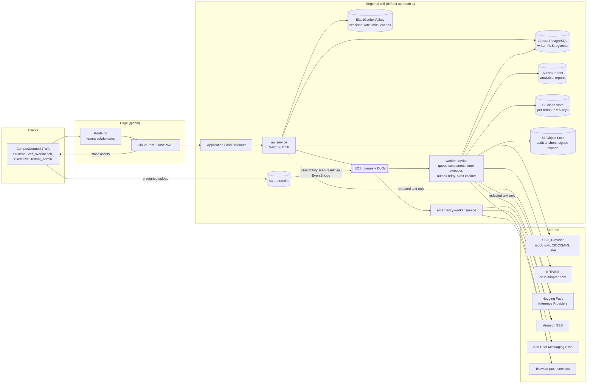
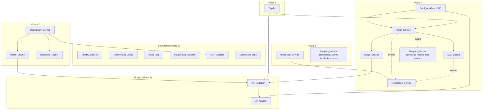
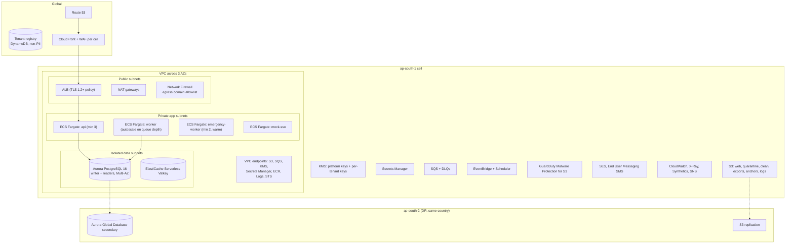
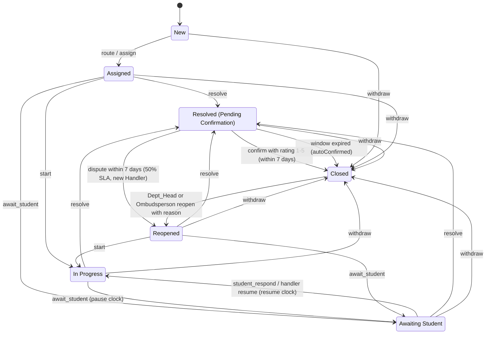
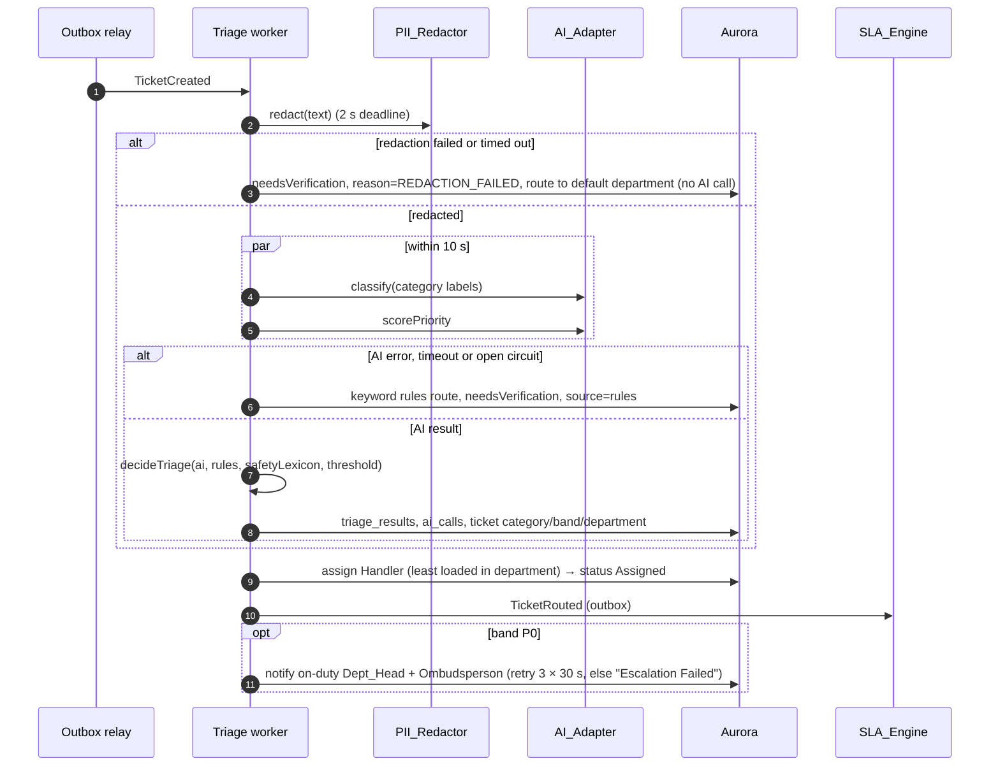
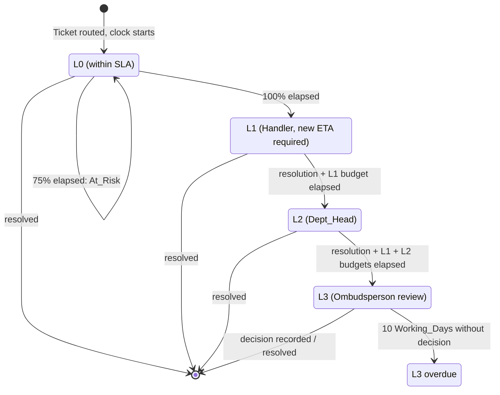
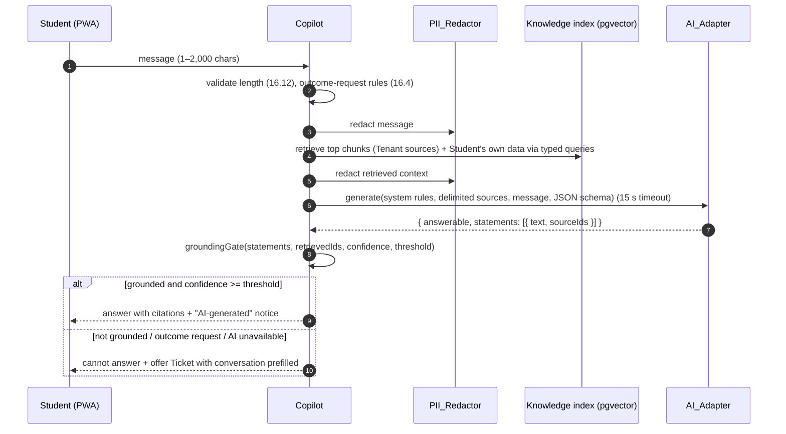
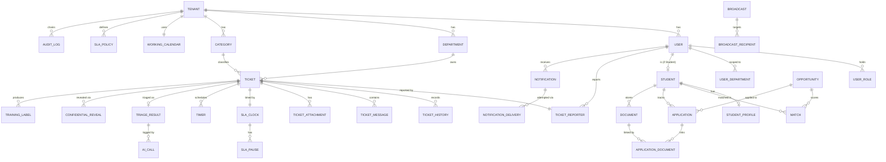

# Design Document: CampusConnect Platform

## Overview

CampusConnect is a multi-tenant SaaS platform for student–institution communication and campus services. This document gives the technical design for all four phases defined in requirements.md. The Phase Mapping table in requirements.md decides delivery order. Each component below is tagged with the phase that introduces it.

The design has four goals:

- **Isolation in the database.** Tenant isolation is enforced by PostgreSQL row-level security (RLS), so a query that forgets a tenant filter returns no rows instead of another institution's data.
- **Assistive AI only.** Every AI output is a labelled suggestion. Every AI path has a deterministic fallback. No text leaves the platform unless it has passed the PII_Redactor, and the type system makes it impossible to call the AI_Adapter with unredacted text.
- **Pure, testable business rules.** The ticket state machine, working-calendar maths, escalation ladder, k-anonymity, eligibility, ranking, notification fallback, retry policy, lockout and the audit hash chain live in one I/O-free TypeScript package (`packages/domain`). Correctness properties are tested there with fast-check.
- **One foundation for all phases.** Phase 1 ships identity, tenancy, audit, notifications, async processing and observability at production quality. Later phases add modules without restructuring.

### Key design decisions

| # | Decision | Choice | Rationale | Alternatives considered |
|---|---|---|---|---|
| D1 | Service shape | Modular monolith. One NestJS codebase deployed as an `api` service (HTTP) and a `worker` service (queues, timers). | 16 components, one team, and tight transactional coupling between Ticket_Service, SLA_Engine and Audit_Log. Module boundaries are enforced by package boundaries and dependency rules, so a module can be extracted later. | One microservice per component. Rejected for Phase 1: distributed transactions and operating cost. |
| D2 | Compute | ECS Fargate for `api`, `worker`, `emergency-worker` and `mock-sso` | Long-lived tasks keep a stable `node-postgres` pool, which suits transaction-scoped RLS settings. | Lambda with RDS Proxy. Rejected: RDS Proxy pins connections when it sees session state changes, and cold starts threaten the 500 ms p95 read target. |
| D3 | Database | Aurora PostgreSQL 16 (provisioned, Multi-AZ, one writer and at least one reader) with `pgvector`, `pg_trgm`, `pgcrypto` | RLS, transactional outbox, full-text search and vector search in one store. | A separate vector store (OpenSearch). Rejected at this scale. |
| D4 | Multi-tenancy | Shared schema. `tenant_id` on every row. RLS with `FORCE ROW LEVEL SECURITY`. Settings applied with transaction-local `set_config`. | The database enforces isolation. | Schema-per-tenant or database-per-tenant. Rejected: migrations across hundreds of tenants. Can be offered later as a dedicated cell. |
| D5 | Data residency | Regional cells. Each AWS region runs a full stack. A small global tenant registry maps tenant to region. | Requirement 1.9. India Tenants default to ap-south-1, which is also required for DLT-registered local SMS routes to India. | A single global stack. Rejected: residency. |
| D6 | Async work | Transactional outbox → SQS standard queues, each with a DLQ. SLA deadlines are rows in a `timers` table processed by a sweeper. | The outbox guarantees that no domain event is lost. Recalculating an SLA is a row update. | One EventBridge Scheduler schedule per deadline. Rejected: millions of schedules and awkward recalculation. |
| D7 | Audit log | Per-tenant hash chain in Aurora, plus hourly anchoring of each chain head into an S3 Object Lock bucket (compliance mode) | Meets 18.3. Anchoring detects a rewrite by a database superuser. | Amazon QLDB. Rejected: support ended on 31 July 2025. |
| D8 | AI provider | Hugging Face Inference Providers through `@huggingface/inference`, behind `AiAdapter` | User decision. One token and one client cover classification, feature extraction (embeddings) and chat completion. | An Amazon Bedrock adapter can be added behind the same interface. |
| D9 | Frontend | One Next.js app built as a static export (`output: "export"`), served from S3 through CloudFront. Client-side data fetching with TanStack Query. Serwist service worker. | Every screen is authenticated, so server rendering adds little. Static assets help LCP on 4G and make offline caching simple. | Next.js server rendering on Fargate. Rejected: more infrastructure, harder offline. |
| D10 | Sessions | Opaque session id in an `HttpOnly; Secure; SameSite=Lax` cookie. Session state in ElastiCache Serverless (Valkey) with a sliding idle TTL. | Server-side revocation, idle timeout (2.7), lockout counters and rate limits share one store. | JWT access tokens. Rejected: idle expiry and revocation are awkward. |
| D11 | Malware scanning | GuardDuty Malware Protection for S3 on a quarantine bucket; results consumed from EventBridge | Managed scanning of new uploads with event-driven results. | ClamAV on Fargate. Rejected: signature update operations. |
| D12 | Messaging channels | SES (email), Web Push with VAPID (push), AWS End User Messaging SMS (SMS), in-app inbox in Postgres | All in-region. | A third-party CPaaS can be added behind `ChannelAdapter`. |
| D13 | Testing | Vitest, fast-check, Testcontainers (PostgreSQL), Playwright, axe-core, k6, OWASP ZAP | TypeScript-native tooling. fast-check is the standard property-based testing library for TypeScript. | Jest. Works, but slower with ESM and TypeScript decorators. |
| D14 | Regex engine for PII detection | `re2` (linear-time) | Guarantees the 2-second redaction budget (5.1) cannot be broken by catastrophic backtracking. | JavaScript `RegExp`. Rejected for untrusted input. |

### Research findings

- **Hugging Face Inference Providers.** Chat completion is available through an OpenAI-compatible endpoint at `https://router.huggingface.co/v1/chat/completions`. Other tasks, such as feature extraction for embeddings, use the official JavaScript or Python clients. By default the router picks the fastest available provider; a suffix such as `:cheapest`, or a provider name, pins the choice. ([Inference Providers documentation](https://huggingface.co/docs/inference-providers/en/index)) HF Inference, formerly the serverless Inference API, is one of these providers; dedicated Inference Endpoints are the option for dedicated, autoscaling capacity. ([HF Inference](http://huggingface.co/docs/inference-providers/providers/hf-inference)) *Design impact:* the HF adapter uses `@huggingface/inference` for every task and pins a model and provider per purpose in configuration, so latency and data-handling terms are predictable.
- **PostgreSQL RLS for SaaS.** The production pattern is one transaction per request, `set_config('app.tenant_id', $1, true)` at its start, and policies that compare `tenant_id` with that setting, backed by negative tests that prove cross-tenant reads return nothing. ([Postgres RLS production pattern](https://theroadtoenterprise.com/blog/postgres-rls-multi-tenant-saas)) Careless policies can turn index scans into sequential scans. ([RLS performance](https://dev.to/software_mvp-factory/postgresql-row-level-security-without-the-performance-tax-436g)) *Design impact:* policies wrap setting lookups in `(select ...)` so the planner evaluates them once per statement, and every index leads with `tenant_id`.
- **RDS Proxy.** RDS Proxy pins a client to one database connection when it detects session state changes. ([RDS Proxy pinning](https://docs.aws.amazon.com/en_us/AmazonRDS/latest/UserGuide/rds-proxy-pinning.html)) *Design impact:* decision D2.
- **pgvector on Aurora.** Aurora PostgreSQL supports pgvector 0.8.0 on PostgreSQL 16.8 and later, with HNSW indexes. ([AWS announcement](https://aws.amazon.com/about-aws/whats-new/2025/04/pgvector-0-8-0-aurora-postgresql/))
- **SMS to India.** AWS End User Messaging SMS supports local India routes with DLT-registered sender IDs only through ap-south-1 and ap-south-2. Message text must exactly match the DLT-registered template. ([India sender ID support](https://docs.aws.amazon.com/sms-voice/latest/userguide/registrations-sms-senderid-india-support.html), [Entity and template IDs](https://docs.aws.amazon.com/sms-voice/latest/userguide/registrations-sms-senderid-india-specify-ids.html)) *Design impact:* emergency SMS uses pre-registered templates with variable slots. Free-form SMS is not offered.
- **Malware scanning.** GuardDuty Malware Protection for S3 scans newly uploaded objects, can tag them with the result, and publishes results to EventBridge. ([GuardDuty Malware Protection for S3](https://docs.aws.amazon.com/guardduty/latest/ug/gdu-malware-protection-s3.html))
- **Ledger database.** Amazon QLDB support ended on 31 July 2025. ([InfoQ](https://www.infoq.com/news/2024/07/aws-kill-qldb)) *Design impact:* decision D7.
- **fast-check.** fast-check works with any test runner, including Vitest, and allows global configuration of the number of runs and the seed. ([fast-check configuration](https://fast-check.dev/docs/configuration/))

*Content was rephrased for compliance with licensing restrictions.*

### Requirement gaps and interim resolutions

requirements.md is approved and is not changed by this design. The items below are inconsistencies or gaps found while designing. Each has an interim resolution that the rest of this document uses. If the product owner prefers a different answer, requirements.md can be updated and this design will follow.

| # | Gap | Requirements | Interim resolution |
|---|---|---|---|
| G1 | Four different k rules. The Glossary says k is 5 unless a Tenant sets a higher value. 1.6 accepts 2 to 1000. 14.5 configures cluster k from 3 to 20. 15.4 requires k of at least 5 for exports. | Glossary, 1.6, 14.5, 15.4 | Two settings. `kAnonymity` accepts 2–1000 (1.6), and the effective value is `max(5, kAnonymity)` (Glossary, 15.4). `spikeClusterK` accepts 3–20, default 5 (14.5). |
| G2 | The Broadcast cap is 50,000 recipients (13.1), but 23.6 requires enqueuing 100,000, and Tenants have up to 100,000 Students. | 13.1, 23.6 | The platform is sized for 100,000. The cap is a Tenant setting defaulting to 50,000. Emergency alerts are exempt from the cap. Needs confirmation. |
| G3 | 21.11 notifies a "product owner role", but 2.2 allows exactly six Tenant roles. | 2.2, 21.11 | Product owner is a platform-operator role in the operator console, outside Tenant RBAC. |
| G4 | 18.8 forbids free-text Ticket content in the Audit_Log, while 6.10, 7.8, 8.2 and 13.11 require reasons and Broadcast content in audit entries. | 18.8; 6.10, 7.8, 8.2, 13.11 | Staff-entered reasons and Broadcast content pass through the PII_Redactor before they are written to an audit entry. Ticket descriptions, messages and internal notes are never written to the Audit_Log. |
| G5 | 3.6 falls back after 3 seconds; 23.8 after 10 seconds. | 3.6, 23.8 | Client and server both stop at 3 seconds, which satisfies both. |
| G6 | 5.10 routes by keyword rules when AI is down. 23.7 keeps the Ticket in its created state after 30 seconds. | 5.10, 23.7 | 5.10 applies when the AI_Adapter fails fast (error, 10-second timeout or open circuit breaker). 23.7 is a watchdog for when the triage job has not run at all (queue backlog or worker outage). The Ticket stays New, is flagged `pendingManualTriage`, and appears in the default department's Needs_Verification_Lane. |
| G7 | 6.4 asks to notify the Student of the "new ETA" at escalation time, before the Handler has entered one. | 6.4 | At L1 the Student is told the Ticket is escalated, with an interim ETA equal to the L2 threshold time. When the Handler enters the required ETA, the Student is notified again. The Staff_Workbench blocks other actions on the Ticket until the ETA is entered. |
| G8 | 6.12 blocks the SLA_Clock when the calendar is missing, even for P0, whose clock ignores the calendar. | 6.2, 6.12 | Follow 6.12 as written. Tenant provisioning always creates a default calendar, and a calendar can be replaced but not deleted, so this path should be rare. |
| G9 | 4.10 requires a different Handler after a dispute, but a department may have only one Handler. | 4.10 | Choose the least-loaded active Handler in the department other than the previous resolver. If there is none, assign the department's Dept_Head. |
| G10 | 11.2 excludes ineligible Students but does not say what happens when eligibility is "unknown" (11.4). | 11.2, 11.4 | Only "not met" excludes. Students whose result is "unknown" are recommended, with the unknown criteria flagged, to reduce opportunity leakage (H4). |
| G11 | 3.11 does not define "link". | 3.11 | Link appends the new text as a Student message on the existing Ticket and creates no new Ticket. |
| G12 | VOTR and first-response time need exact definitions. | Introduction, 14.1, 21.1, 21.2 | VOTR's denominator excludes Withdrawn closures. A closed Ticket's VOTR contribution is provisional until 7 days after closure. First-response time is SLA_Clock elapsed time, which is working time for P1–P3. |
| G13 | 13.4 (95% of recipients within 60 seconds, including SMS) depends on SMS and SES throughput quotas that AWS sets per account. | 13.4, 23.6 | "Delivered" means received on at least one channel. In-app and web push carry the 60-second target. Raising SMS and SES quotas is an operational prerequisite for Phase 3 GA. |
| G14 | Hugging Face Inference Providers may route requests to third-party providers outside India. | 1.9, 19.6, 19.8 | Only redacted text is sent. A provider is pinned per purpose and chosen for no-retention and no-training terms. A dedicated HF Inference Endpoint in an Indian region is the upgrade path. Needs legal review. |
| G15 | 7.3 says the Needs_Verification_Lane lists every Ticket with an unconfirmed AI suggestion; the Glossary and 5.5 say it holds Tickets below the confidence threshold. | Glossary, 5.5, 7.3 | Lane membership is `needsVerification = true` (below threshold, rule-based fallback, redaction failure or pending manual triage) and not yet confirmed or corrected by a Handler. Above-threshold suggestions are applied and can still be corrected from the Ticket view. |
| G16 | The SLA after a Dept_Head or Ombudsperson reopens a Closed Ticket (4.14) is not stated. | 4.10, 4.14 | Use the dispute rule: 50% of the original SLA. |

## Architecture

### Logical architecture



### Module map and dependency rules

Each requirement component is a NestJS module in `packages/server/<module>`. The `api` app hosts controllers. The `worker` app hosts queue consumers and scheduled jobs. Both import the same modules.



Every module also depends on Identity_Service (request context and authorisation), Tenancy and Config, Audit_Log and Outbox and Jobs. Those edges are omitted from the diagram.

Dependency rules, enforced in CI with `dependency-cruiser`:

1. A module calls another module only through the public service interface exported from that module's `index.ts`.
2. A module reads and writes only its own tables. Cross-module reactions go through domain events in the outbox.
3. Analytics_Service reads only its own fact tables in the `analytics` schema. Projections populate them from domain events and nightly snapshots.
4. Only `packages/ai-adapter` may make network calls to an AI provider. Only `packages/pii-redactor` may create a `RedactedText` value.
5. `packages/domain` imports nothing that performs I/O.
6. Only `packages/db` may import the PostgreSQL driver. All other code uses `withTenant()`.

### Monorepo layout

pnpm workspaces with Turborepo. Node.js 22 LTS. TypeScript in strict mode everywhere.

```text
campusconnect/
├─ apps/
│  ├─ web/            Next.js PWA. Route groups: (student), (workbench), (exec), (admin), (ops)
│  ├─ api/            NestJS HTTP entry point: controllers, guards, pipes, OpenAPI
│  ├─ worker/         NestJS standalone entry point: SQS consumers, sweeper, outbox relay, audit chainer
│  └─ mock-sso/       Mock SSO_Provider (OIDC-shaped) for development and the first release
├─ packages/
│  ├─ domain/         Pure logic, no I/O: ticket state machine, working calendar, SLA clock,
│  │                  escalation, eligibility, ranking, k-anonymity, notification fallback,
│  │                  retry policy, lockout, rate limit, hash chain, metric definitions, validation
│  ├─ contracts/      Zod schemas and TypeScript types: API DTOs, domain events, validation catalogue
│  ├─ server/         NestJS modules, one folder per component:
│  │                  identity, tenancy, tickets, triage, sla, workbench, notifications,
│  │                  broadcasts, opportunities, matching, documents, copilot, analytics,
│  │                  audit, privacy, erp, outbox
│  ├─ db/             Drizzle ORM schema, SQL migrations, RLS policies, withTenant() helper
│  ├─ pii-redactor/   Detectors, span merger, placeholder writer, RedactedText brand
│  ├─ ai-adapter/     AiAdapter interface, HuggingFaceAdapter, FakeAiAdapter, circuit breaker
│  ├─ erp-adapter/    ErpAdapter interface, StubErpAdapter
│  ├─ sso-adapter/    SsoProvider interface, MockSsoProvider client
│  ├─ channels/       ChannelAdapter interface; in-app, SES, Web Push and SMS adapters; templates
│  ├─ observability/  pino logger with allowlist serialisers, OpenTelemetry setup
│  ├─ i18n/           English and Hindi resources, locale manifest
│  ├─ ui/             Accessible React components built on React Aria Components
│  └─ tooling/        tsconfig, ESLint, Vitest presets, dependency-cruiser rules
├─ infra/             AWS CDK app (TypeScript)
│  └─ lib/stacks/     network, data, security, compute, edge, messaging, observability, pipeline
├─ tools/             seed data, security-exception validator, AI evaluation harness, load tests
├─ pnpm-workspace.yaml
└─ turbo.json
```

The ORM is Drizzle because it is SQL-first, generates typed queries, and leaves migrations as plain SQL, which is where the RLS policies live.

### Request lifecycle and tenant context

```mermaid
sequenceDiagram
  autonumber
  participant C as PWA
  participant G as Guards (api)
  participant KV as Valkey
  participant S as Module service
  participant DB as Aurora (RLS)
  C->>G: HTTPS request + cc_session cookie
  G->>KV: load session, refresh idle TTL
  alt no session, expired, or tenant unresolved
    G-->>C: 401 AUTHENTICATION_REQUIRED (no data store access)
    G->>S: audit "auth.rejected" (separate transaction)
  end
  G->>G: host tenant == session tenant? else 403 + cross-tenant audit
  G->>G: authorize(principal, resource, action)
  G->>S: call with RequestContext (AsyncLocalStorage)
  S->>DB: BEGIN; set_config(app.tenant_id, app.user_id, app.roles, app.dept_ids, true)
  S->>DB: state change + outbox rows + audit_pending rows
  S->>DB: COMMIT
  S-->>C: response (problem+json on error)
```

1. The session holds `userId`, `tenantId`, `roles`, `departmentIds`, `mfaVerified` and `lastActivityAt`. Tenant resolution comes only from the session (1.2). The host name must match the session's tenant.
2. `RequestContext` lives in AsyncLocalStorage (via `nestjs-cls`) for the life of the request.
3. `withTenant(ctx, fn)` opens a transaction and sets four transaction-local settings before `fn` runs. Because the settings are local, a pooled connection never carries one tenant's settings into another request.
4. The state change, its outbox events and its `audit_pending` rows commit in one transaction. This gives audit-or-nothing behaviour (18.9).

### Asynchronous processing

**Transactional outbox.** Modules write domain events (`TicketCreated`, `TicketStatusChanged`, `OpportunityPublished`, and so on) to `outbox` in the same transaction as the state change. The outbox relay in `worker` claims batches with `FOR UPDATE SKIP LOCKED` through a `SECURITY DEFINER` function, publishes them to SQS and marks them published. Delivery is at-least-once, so consumers are idempotent: each consumer records `(consumer, event_id)` in `processed_events` in the same transaction as its effect.

**Queues.** All queues are SQS standard queues encrypted with KMS. Each has a DLQ.

| Queue | Producer | Consumer | Purpose |
|---|---|---|---|
| `triage` | outbox (`TicketCreated`) | Triage_Service | Redact, classify, prioritise, route |
| `sla` | outbox (status, band, assignment events) | SLA_Engine | Start, pause, resume, recalculate clocks and timers |
| `timers` | timer sweeper | SLA_Engine, Ticket_Service | Fire At_Risk, breach, escalation, confirmation-window and 7-day events |
| `notify` | outbox | Notification_Service | Resolve recipients, create notifications and deliveries |
| `deliver-push`, `deliver-email` | Notification_Service | channel workers | Per-channel delivery with retry and fallback |
| `emergency` | Broadcast_Service | `emergency-worker` | Emergency fan-out on dedicated capacity |
| `broadcast` | Broadcast_Service | worker | Non-emergency fan-out |
| `match`, `embed` | outbox | Match_Engine, Opportunity_Service | Matching and embedding regeneration |
| `files` | EventBridge (GuardDuty results) | Document_Locker, Ticket_Service | Promote clean files, reject infected files |
| `erp-sync` | EventBridge Scheduler | ERP module | Daily synchronisation and retries |
| `reports`, `analytics` | EventBridge Scheduler, sweeper | Analytics_Service | Reports, fact refresh, spike detection, exports |
| `privacy` | Privacy module, scheduler | Privacy module | Data export, erasure, retention |

**Retry and dead-lettering (24.6).** A consumer that throws changes the message's visibility timeout to the next backoff delay. The delay for retry `n` (1 to 5) is `5 s × 2^n` plus up to 20% jitter, so delays strictly increase. `maxReceiveCount` is 6 (one attempt plus five retries); SQS then moves the message to the DLQ. Specific features use their own retry policies (for example 3 retries at 30-second intervals for P0 escalation notifications, 5.7). All policies are values of one `RetryPolicy` type in `packages/domain` and run through one executor.

**Timers.** SLA and lifecycle deadlines are rows in `timers (tenant_id, ticket_id, kind, due_at, generation)`. Recalculating a clock upserts the rows and increments `generation`. The sweeper runs every 10 seconds, claims due rows with `SKIP LOCKED` through a `SECURITY DEFINER` function, and enqueues them to `timers` with their generation. A handler ignores a message whose generation is older than the row's current generation. A 10-second sweep plus queue latency keeps every "within 1 minute" SLA requirement (6.3–6.6) well inside budget.

**Audit chainer.** Business transactions write `audit_pending` rows. A per-tenant chainer loop (single holder per tenant through `pg_try_advisory_lock`) runs every 500 ms, assigns sequence numbers, computes hashes and moves rows into `audit_log`. This keeps per-tenant serialisation off the request path while meeting the 2-second recording target (18.1).

**Scheduled jobs.** EventBridge Scheduler sends cron-style messages for ERP sync, analytics refresh (every 5 minutes), report schedules (every minute, the job selects due schedules), retention (daily), DLQ re-alerting (hourly) and digests.

### AWS deployment topology



- **Cells.** One full stack per region. India Tenants run in ap-south-1. The tenant registry stores only tenant id, slug, region and status. Each Tenant gets a subdomain (`{slug}.campusconnect.app`) whose Route 53 record points to its cell's CloudFront distribution.
- **Network.** Three AZs. The ALB uses a TLS 1.2+ security policy and redirects HTTP to HTTPS. Application tasks run in private subnets and data stores in isolated subnets. AWS Network Firewall allows outbound traffic only to an allowlist (the Hugging Face router, browser push services, SSO and ERP endpoints once real).
- **Compute.** `api` runs at least 3 tasks and scales on CPU and ALB request count. `worker` scales on SQS backlog per task. `emergency-worker` keeps at least 2 warm tasks and its own queue so ordinary backlog cannot delay emergency alerts.
- **Data.** Aurora PostgreSQL 16 with `rds.force_ssl = 1`, encrypted with a platform KMS key, backup retention 14 days (point-in-time recovery covers the 7 days required by 24.3). Aurora Global Database to ap-south-2 gives a cross-region recovery point measured in seconds while keeping data in India (24.4).
- **Storage.** Separate S3 buckets for web assets, quarantine, clean store (attachments and Document_Locker), exports, audit anchors (Object Lock compliance mode, 3-year default retention) and access logs. All buckets block public access and enforce TLS.
- **Keys.** Platform KMS keys for Aurora, SQS, Valkey and logs. Each Tenant gets a symmetric KMS key for its objects in the clean store (22.3) and an asymmetric `ECC_NIST_P256` signing key for signed exports (15.4). Tenant keys are created at provisioning time, not by CDK.
- **Infrastructure as code (22.10).** One CDK app with stacks for network, data, security, compute, edge, messaging, observability and the delivery pipeline. `cdk-nag` (AwsSolutions rules) runs on every synth.

### Observability

- **Logs.** `pino` JSON logs to CloudWatch Logs. Log calls accept only a typed `LogFields` object built from an allowlist (`requestId`, `tenantId`, `route`, `status`, `durationMs`, `errorCode`, `actorRef`, and similar). Free-text fields cannot be logged. `actorRef` is an HMAC of the user id with a per-tenant key, so engineers can correlate one user's requests without seeing an identifier (25.1).
- **Metrics.** CloudWatch Embedded Metric Format. Request rate, errors and duration per route; queue depth and oldest-message age; DLQ size; AI latency and errors per purpose; sweeper lag; audit chainer lag; delivery outcomes per channel.
- **Traces.** OpenTelemetry SDK to the AWS Distro for OpenTelemetry collector, exported to X-Ray. Span attributes are limited to `tenant.id`, `request.id` and technical attributes.
- **Alarms (25.2).** Error rate above 5% over 5 minutes; p95 latency above 2 seconds over 5 minutes; any queue above 1,000 visible messages for 5 consecutive 1-minute periods. Alarms publish to SNS, which forwards to the operations channel through AWS Chatbot within 60 seconds. DLQ age above 15 minutes raises an alarm; an hourly job repeats the alert while the DLQ is not empty (24.7), because CloudWatch alarms do not repeat.
- **Synthetic checks (24.1, 24.2).** CloudWatch Synthetics canaries run every minute against a synthetic Tenant: Ticket submission, Staff_Workbench queue load, and an emergency alert through the in-app channel. Availability is computed from canary success.
- **AI quality (25.3–25.7).** A nightly job computes per-category accuracy, calibration and override rate from Handler confirmations and corrections. See Analytics_Service.

### Security controls

| Control | Mechanism | Requirements |
|---|---|---|
| TLS everywhere | CloudFront `TLSv1.2_2021` policy, ALB TLS 1.2+ policy, HTTP→HTTPS redirect, HSTS, `rds.force_ssl`, TLS to Valkey, SQS and S3 bucket policies requiring `aws:SecureTransport` | 22.1, 22.2 |
| Encryption at rest | KMS on Aurora, S3, SQS, Valkey, logs; per-tenant keys for attachments and Document_Locker | 22.3, 12.2 |
| Tenant isolation | RLS on every tenant table, `FORCE ROW LEVEL SECURITY`, app role without `BYPASSRLS` | 1.1, 1.4 |
| Authentication | Mock SSO behind `SsoProvider`; TOTP MFA for staff roles; lockout; idle expiry | 2.1–2.10 |
| Authorisation | Deny-by-default RBAC matrix plus department and ownership scoping, mirrored in RLS policies | 2.4–2.6 |
| Input validation | Zod schemas from `packages/contracts` on every endpoint; unknown fields rejected | 22.4 |
| Output safety | User text stored as plain text; `sanitize-html` with no allowed tags on input; React text rendering only (no `dangerouslySetInnerHTML`); strict Content Security Policy | 22.5 |
| Secrets | Secrets Manager with rotation; nothing in code or bundles; `gitleaks` on every build | 22.6 |
| Rate limiting | Valkey sliding-window counters per user and per Tenant; limits in a config table; AWS WAF rate-based rules at the edge for unauthenticated traffic | 22.7, 22.8 |
| Supply chain | OSV-Scanner and `pnpm audit` on every build; critical findings block release unless `security/exceptions.yaml` holds an approved, unexpired exception | 22.9 |
| Application security testing | Semgrep SAST on every build; OWASP ZAP full scan against staging before each phase GA with a gate on high and critical findings | 22.11 |
| AI egress | `RedactedText` brand type, runtime check in the adapter, Network Firewall allowlist | 5.14, 16.3 |
| Malware | GuardDuty Malware Protection for S3 on quarantine; files promoted only after a clean result | 3.16, 12.9 |

## Components and Interfaces

All HTTP endpoints are under `/api/v1`, use JSON, are described by OpenAPI generated from Zod schemas, and return errors as RFC 9457 `application/problem+json` (see Error Handling). Create endpoints accept an `Idempotency-Key` header. Ticket commands use `If-Match` with the Ticket version for optimistic concurrency. Lists use cursor pagination.

### Identity_Service (Phase 1)

Responsibilities: sign-in through the SSO_Provider, MFA for staff, sessions, lockout, RBAC, department scoping and tenant context.

```ts
// packages/sso-adapter
export interface SsoProvider {
  readonly kind: 'mock' | 'oidc' | 'saml';
  buildAuthorizationRequest(tenant: TenantRef, returnTo: string):
    Promise<{ redirectUrl: string; state: string; nonce: string }>;
  /** Rejects with SsoUnavailableError if the provider does not answer within 10 s (2.10). */
  handleCallback(tenant: TenantRef, params: Record<string, string>,
    expected: { state: string; nonce: string }): Promise<SsoIdentity>;
}
export interface SsoIdentity {
  externalSubject: string;            // stable id from the IdP
  authMethods: string[];              // e.g. ['pwd'] or ['pwd','otp'] (OIDC amr)
}

// packages/server/identity
export interface Principal {
  userId: UserId; tenantId: TenantId; roles: Role[];        // at least one (2.2)
  departmentIds: DepartmentId[]; grants: Grant[];            // e.g. 'opportunity.publish', 'broadcast.approve'
  enrolmentStatus?: 'active' | 'inactive';                  // Students only (17.9)
}
export type Role = 'student' | 'handler' | 'dept_head' | 'executive' | 'ombudsperson' | 'tenant_admin';
```

**Sign-in flow.** `GET /auth/login` redirects to the SSO_Provider (2.1). `GET /auth/callback` validates `state` and `nonce`, then:

1. Checks lockout. A locked account gets `ACCOUNT_LOCKED` with the unlock time (2.9).
2. Resolves the user by `externalSubject`. On a Student's first sign-in, the ERP module creates the Student record from ERP_Adapter data within 5 seconds (17.3). If the ERP has no record, sign-in fails with `ACCOUNT_NOT_IN_RECORDS` and no partial record is written (17.4).
3. For any staff role, requires a TOTP challenge (`otplib`, secrets encrypted with a platform KMS key) before the session exists (2.3).
4. Creates the session in Valkey with TTL equal to the Tenant's idle timeout (default 30 minutes, 5–480 allowed, 2.7) and sets the cookie.
5. On a Student's first sign-in, shows the privacy notice and consent choices (19.1).

The mock SSO (`apps/mock-sso`) is a small OIDC-shaped server with users seeded per Tenant from the ERP stub data. It has switchable failure modes (unavailable, slow, wrong password) so the failure paths in 2.9 and 2.10 can be tested. Real OIDC (`openid-client`) and SAML (`@node-saml/node-saml`) implementations plug into the same interface (2.8).

**Lockout (2.9).** Pure function in `packages/domain`:

```ts
export function lockoutState(attempts: AuthAttempt[], now: Instant,
  p = { maxFailures: 5, window: minutes(15), lockFor: minutes(15) }): { locked: boolean; until?: Instant };
```

An account is locked when its last 5 counted attempts are all failures and the first and fifth are at most 15 minutes apart; the lock lasts 15 minutes from the fifth failure. Attempts made during a lock are rejected and not counted. A success resets the run. Failed MFA codes count as failures.

**RBAC (2.4–2.6).** Permissions are a static matrix in `packages/domain/rbac.ts`. `authorize(principal, resource, action, attrs)` returns `allow` only if some role of the principal grants the action and the scope predicate holds. Everything else is denied (`INSUFFICIENT_PERMISSION`, audit entry, no state change, 2.5).

| Resource / action | Student | Handler | Dept_Head | Executive | Ombudsperson | Tenant_Admin |
|---|---|---|---|---|---|---|
| Ticket create, own read, respond, confirm, dispute, withdraw | own; write only if enrolment active | – | – | – | – | – |
| Ticket read and work (assign, status, reply, notes, band) | – | assigned departments | assigned departments | – | Grievances and L3 | – |
| Reopen a Closed Ticket | – | – | assigned departments | – | all | – |
| Reveal confidential identity, record L3 decision | – | – | – | – | yes | – |
| AI override rate | – | – | assigned departments | – | – | – |
| Publish Opportunity | – | with grant | with grant | with grant | – | with grant |
| Non-emergency Broadcast | – | – | own departments' audience | yes | – | yes |
| Emergency alert | – | – | – | yes | – | yes |
| Approve Broadcast | – | – | – | with grant | – | with grant |
| Dashboards, spike alerts, incidents | – | – | assigned departments | all | – | – |
| Schedule reports | – | – | assigned departments | all | – | – |
| Annual signed export | – | – | – | yes | – | – |
| Audit search and verification, Tenant configuration | – | – | – | – | – | yes |
| Copilot | yes | – | – | – | – | – |

Scope predicates use the principal's `departmentIds`, ownership (`reporterId = userId`), confidential-reveal records and enrolment status (an inactive Student keeps read access to own Tickets only, 17.9). The same predicates are expressed as RLS policies (see Data Models), so a bug in one layer is caught by the other.

**Tenant resolution failures (1.3, 1.4).** A request without a valid session gets `401 AUTHENTICATION_REQUIRED` before any business data access, and an `auth.rejected` audit entry. A request whose host or path refers to a resource in another Tenant gets `403 ACCESS_DENIED`. The same response is returned when the resource does not exist, so existence is never revealed. When an id lookup returns nothing under RLS, the service calls the `SECURITY DEFINER` function `owner_tenant_of(resource_type, id)`, which returns only a tenant id. If it differs from the caller's Tenant, the service writes a `tenant.cross_access_denied` audit entry with requesting Tenant, targeted Tenant, user and timestamp.

### Tenancy and Configuration (Phase 1)

```ts
export interface TenantConfig {
  timeZone: string;                    // IANA, default 'Asia/Kolkata'
  region: AwsRegion;                   // default 'ap-south-1' (1.9)
  confidenceThreshold: number;         // 0.00–1.00, default 0.70 (5.5)
  duplicateThreshold: number;          // 0.00–1.00, default 0.60 (3.11)
  copilotConfidenceThreshold: number;  // 0.00–1.00, default 0.70 (16.2)
  kAnonymity: number;                  // 2–1000, default 5; effective max(5, k) (G1)
  spikeClusterK: number;               // 3–20, default 5 (14.5)
  sessionIdleMinutes: number;          // 5–480, default 30 (2.7)
  smsEnabled: boolean; broadcastApprovalRequired: boolean;
  broadcastRecipientCap: number;       // default 50,000 (G2)
  executiveDigest: { weekday: 1..7; time: 'HH:mm' };   // default Monday 08:00 (14.2)
  trainingLabelOptIn: boolean;         // 25.5, 25.6
}
```

Categories, departments, routing rules, SLA policies and the working calendar are separate tables. Every write goes through the validation catalogue (see Data Models). Invalid values are rejected with the field path and the saved configuration is untouched (1.6). Because each row carries `tenant_id` under RLS, a change can only affect the Tenant in context (1.5).

**Provisioning (1.7, 1.8)** is a short saga run by the operator console:

1. Create the Tenant's KMS data key and signing key. These are outside the database transaction.
2. In one database transaction: insert the tenant row, default configuration, roles, departments placeholder, default categories, default SLA policies and the default working calendar (Monday–Friday 09:00–17:00 in the Tenant time zone).
3. Register the Tenant in the global registry and create its DNS record.

If step 2 fails, the transaction rolls back and the KMS keys from step 1 are scheduled for deletion. If step 3 fails, step 2 is undone by deleting the tenant (cascade) and step 1 is compensated. Each failure is reported to the requester and audited in a separate transaction. The target end-to-end time is under 30 seconds; the saga has a 25-second deadline and compensates if it is exceeded.

Default SLA policies, all Tenant-configurable:

| Band | First response | Resolution | Clock | L1 escalation budget | L2 escalation budget |
|---|---|---|---|---|---|
| P0 Critical | 60 min | 24 h | continuous | 4 h | 8 h |
| P1 High | 4 working h | 2 Working_Days (960 working min) | working | 1 Working_Day | 2 Working_Days |
| P2 Normal | 1 Working_Day (480 working min) | 5 Working_Days | working | 2 Working_Days | 3 Working_Days |
| P3 Low | 2 Working_Days | 10 Working_Days | working | 3 Working_Days | 5 Working_Days |

### Ticket_Service (Phase 1)

Responsibilities: Ticket creation with idempotency, prechecks, attachments, the status state machine, history, assignment, confidentiality, Grievance Committee actions and receipts.

**Endpoints**

| Method and path | Purpose | Requirements |
|---|---|---|
| `POST /triage/suggest` | Category suggestion while typing (at least 20 characters) | 3.5, 3.6, 23.5 |
| `POST /tickets/precheck` | Duplicate and profanity checks | 3.10–3.12 |
| `POST /tickets` (`Idempotency-Key`) | Create Ticket or return existing receipt | 3.9, 3.13 |
| `POST /tickets/{id}/attachments/upload-url` | Presigned POST into quarantine | 3.14–3.16 |
| `GET /tickets?scope=mine`, `GET /tickets/{id}` | Student list and detail with history | 4.3 |
| `POST /tickets/{id}/commands` (`If-Match`) | Status commands, assignment, band change, ETA | 4.x, 6.4, 6.10 |
| `POST /tickets/{id}/messages` | Public reply or internal note | 6.8, 7.11 |
| `POST /tickets/bulk-reassign` | Atomic bulk reassignment | 7.8, 7.9 |
| `POST /grievances/{id}/reveals` | Ombudsperson reveals identity to a named Handler | 8.2, 8.3, 8.8 |
| `POST /grievances/{id}/decision` | L3 decision with rationale | 8.5 |
| `GET /grievances/l3` | L3 list with Working Days remaining | 8.4 |

**Creation.** The PWA generates a UUIDv7 idempotency key when a draft is created and reuses it for every attempt (3.3). The server inserts with `ON CONFLICT (tenant_id, reporter_id, idempotency_key) DO NOTHING RETURNING id`. On conflict it loads the existing Ticket and returns its receipt with `200` instead of `201` (3.9). In the same transaction it:

- stores the original text, plus a redacted copy produced by the PII_Redactor for later AI use;
- runs the local safety lexicon; a match sets band P0 immediately so safety cases never wait for AI (5.6);
- sets category to the Student's accepted or chosen category, and band to the category's default band (or P0);
- computes the receipt commitments as durations from the SLA policy ("first response within 4 working hours", "resolution within 2 Working_Days"), which do not depend on routing time (3.13);
- writes `TicketCreated` to the outbox and a `triage_deadline` timer 30 seconds ahead (23.7).

**Prechecks (3.10–3.12).** Both run locally, with no AI dependency, inside a 5-second budget:

- *Duplicates:* `pg_trgm` `similarity()` between the normalised new text and each of the Student's open Tickets. Results at or above `duplicateThreshold` are returned. The PWA shows them and offers "link" (append as a message on the existing Ticket, G11) or "continue". The text stays in the form either way.
- *Profanity:* English, Hindi and Hinglish word lists with normalisation (case, repeated letters, common character substitutions). A flag asks the Student to review. `POST /tickets` with `profanityConfirmed: true` is accepted; without it a flagged text gets `422 PROFANITY_CONFIRMATION_REQUIRED`.

**Attachments (3.14–3.16).** The upload-url endpoint checks the count (fewer than 5 accepted or pending) and the declared type and size, then returns a presigned POST with a `content-length-range` of 1 byte to 10 MB and a fixed key in the quarantine bucket. GuardDuty scans the object. The `files` consumer then checks magic bytes (PDF, JPEG, PNG, MP4), and promotes clean files to the clean store under the Tenant's KMS key. Infected or mistyped files are deleted, marked rejected with a reason, and the Student is notified. Ticket text and other attachments are never touched by an attachment failure.

**State machine (4.1, 4.2, 4.12–4.14).** The machine is a data table in `packages/domain/ticket-state.ts`. `applyCommand(ticket, command, actor, now)` returns either `{ ticket', events, historyEntry }` or a typed rejection, and never mutates its input.



| Command | Allowed from | Actor | Effect |
|---|---|---|---|
| `route` / `assign` | New | Triage_Service, Handler, Dept_Head | → Assigned; SLA_Clock starts (6.1) |
| `start` | Assigned, Reopened | Handler | → In Progress |
| `await_student` | Assigned, In Progress, Reopened | Handler | → Awaiting Student; clock paused (4.4); 7-day timer (4.6) |
| `student_respond` | Awaiting Student | Student (reporter) | → In Progress; clock resumed (4.5) |
| `resume` | Awaiting Student | Handler | → In Progress; clock resumed |
| `resolve` | Assigned, In Progress, Awaiting Student, Reopened | Handler, Dept_Head | → Resolved (Pending Confirmation); clock stopped; 7-day confirmation timer (4.7) |
| `confirm` (rating 1–5) | Resolved, within window | Student | → Closed; rating stored (4.8) |
| `window_expired` | Resolved | system timer | → Closed; `autoConfirmed = true` (4.9) |
| `dispute` (reason 1–500) | Resolved, within window | Student | → Reopened; owner Dept_Head level; assignee ≠ previous resolver (G9); new clock at 50% budget (4.10) |
| `withdraw` | any except Closed | Student (reporter) | → Closed; `closureReason = Withdrawn` (4.12) |
| `reopen` (reason 1–500) | Closed | Dept_Head, Ombudsperson | → Reopened; 50% budget (4.14, G16) |
| any other | Closed | any | rejected `TICKET_CLOSED`, no change (4.13) |
| `dispute` | Resolved, after window | Student | rejected `CONFIRMATION_WINDOW_ENDED`, no change (4.11) |

Every accepted status change appends one `ticket_history` row with actor, UTC timestamp to the second, previous status, new status and a reason of 1 to 500 characters (system transitions use a fixed reason such as "Auto-confirmed after 7 days"). History is part of the same transaction, so it is visible as soon as the change commits (4.2).

Assignment changes, band changes and ETA updates are commands that do not change status. Each writes history and an audit entry (18.1). Band changes need a reason of 1 to 500 characters (6.10, 6.11). After L1 escalation, the `set_eta` command needs an ETA later than now and at most 30 calendar days ahead (6.4).

**Confidentiality (3.8, 7.10, 8.1–8.3, 8.7, 8.8).** Only Grievances (type Complaint) can be confidential. A confidential Grievance gets an `anonRef` (for example `CONF-7F3K9Q`, 8 random base32 characters, unique per Tenant by constraint). The reporter link lives in `ticket_reporters`, whose RLS policy shows the row only to the reporter, Ombudspersons, and Handlers with a reveal record for that Grievance. Every staff-facing projection (queue rows, Ticket view, search results, notifications, AI summaries) goes through one `projectTicketForViewer(ticket, viewer, reveals)` function in `packages/domain`. For an unauthorised viewer it replaces name, email and student id with `anonRef`. Search indexes are built from Ticket text only, never from reporter identity.

A reveal needs a reason of 10 to 500 characters (8.2, 8.3). The reveal row and its audit entry are inserted in one transaction, so if the audit write fails the reveal is rolled back and the identity stays hidden (8.8). An unauthorised attempt to read a confidential identity returns `403 ACCESS_DENIED` and writes an audit entry (8.7).

**Grievance Committee (8.4, 8.5).** The L3 list shows each open L3 Grievance with `workingDaysRemaining` (see SLA_Engine) and an overdue badge at 0. A decision needs a rationale of 20 to 5,000 characters and emits an event that notifies the Student within 60 seconds.

### PII_Redactor (Phase 1)

```ts
// packages/pii-redactor
declare const redacted: unique symbol;
export type RedactedText = string & { readonly [redacted]: true };   // only this package can mint it

export type PiiType = 'NAME' | 'PHONE' | 'EMAIL' | 'ROLL_NO' | 'GOV_ID' | 'ADDRESS' | 'BANK_CARD';
export interface RedactionResult {
  text: RedactedText;
  spans: Array<{ type: PiiType; start: number; end: number }>;  // offsets in the original
}
export interface PiiRedactor {
  /** Rejects with RedactionTimeoutError after 2 s (5.1, 5.3). */
  redact(input: string, ctx: { tenantId: TenantId; deadlineMs?: number }): Promise<RedactionResult>;
}
```

Detection is layered. All patterns use `re2`.

| Type | Detectors |
|---|---|
| EMAIL | Address pattern, including obfuscations such as "name at domain dot com" |
| PHONE | Indian mobile numbers (`+91`, `0` or no prefix, then 10 digits starting 6–9, with spaces or dashes), landlines, E.164 |
| GOV_ID | Aadhaar-shaped 12-digit groups (redacted whether or not the Verhoeff check passes), PAN, voter id, passport, driving licence formats |
| BANK_CARD | 13–19 digit card sequences (Luhn decides the label, not whether to redact), 9–18 digit account numbers, IFSC codes |
| ROLL_NO | Tenant-configured enrolment patterns from the ERP format, plus a default alphanumeric pattern |
| ADDRESS | Lines containing a 6-digit PIN code or address keywords (house no., flat, road, nagar, sector, colony, street) |
| NAME | Gazetteer of the Tenant's user names from the directory (Latin and Devanagari forms), honorific patterns (Mr, Ms, Dr, Prof, Shri, Smt, Kumari followed by capitalised words) |

Spans are merged (longest span wins, then the fixed type priority above) and replaced right to left with `[PII:TYPE]`. Placeholders match no detector, so redaction is idempotent. The redactor runs in a worker thread with a hard deadline. When it fails or misses the deadline, callers get an error and must not call the AI_Adapter (5.3). The decision to over-redact ambiguous numbers is deliberate: a false positive costs a little classification quality, a false negative is a privacy incident. A local NER model (ONNX through `transformers.js`) for names not in the directory is a Phase 2 enhancement behind the same interface.

### AI_Adapter (Phase 1)

```ts
// packages/ai-adapter
export type AiPurpose = 'triage.category' | 'triage.department' | 'triage.priority' | 'triage.suggest'
  | 'workbench.summary' | 'match.embedding' | 'copilot.embedding' | 'copilot.answer';

export interface AiAdapter {
  classify(req: { purpose: AiPurpose; text: RedactedText; labels: Array<{ id: string; description: string }> },
    opts: CallOptions): Promise<AiResult<{ scores: Array<{ id: string; confidence: number }> }>>;
  scorePriority(req: { text: RedactedText }, opts: CallOptions):
    Promise<AiResult<{ band: 'P0' | 'P1' | 'P2' | 'P3'; confidence: number; safetyRisk: boolean }>>;
  embed(req: { purpose: AiPurpose; texts: RedactedText[] }, opts: CallOptions):
    Promise<AiResult<{ vectors: number[][]; dimensions: number }>>;
  generate(req: { purpose: AiPurpose; system: string; messages: Array<{ role: 'user' | 'assistant'; content: RedactedText }>;
    responseSchema?: JsonSchema; maxTokens: number }, opts: CallOptions): Promise<AiResult<{ text: string }>>;
}
export interface CallOptions { tenantId: TenantId; timeoutMs: number; signal?: AbortSignal }
export interface AiResult<T> { output: T; modelId: string; modelVersion: string; provider: string; latencyMs: number }
```

- **Provider neutrality (5.12).** Callers depend only on this interface. `AI_PROVIDER=huggingface | fake` and per-purpose model settings select the implementation and models, so changing provider is a configuration change.
- **Hugging Face implementation (5.13).** Uses `InferenceClient` from `@huggingface/inference`: `zeroShotClassification` for `classify` with a multilingual NLI model, `featureExtraction` for `embed` with a multilingual embedding model, and `chatCompletion` with a JSON response schema for `scorePriority` and `generate`. Model ids and the provider suffix are configuration (for example an embedding model such as `BAAI/bge-m3`). Phase 1 includes a spike to confirm that each chosen model is served by a provider with acceptable latency and data terms (G14). The HF token is read from Secrets Manager.
- **Egress guard (5.14, 16.3).** Request fields that carry text accept only `RedactedText`. At runtime the adapter also checks every text against the redactor's mint registry (a per-process `WeakRef` set of strings it produced, with a fallback re-scan) and refuses to send anything it cannot verify.
- **Resilience.** Each purpose has a timeout (3 s for suggestions and summaries, 10 s for triage, 15 s for Copilot), a circuit breaker (`opossum`, opens at 50% failures over 30 seconds), and no automatic retry on the request path. An open breaker fails immediately, which triggers the caller's fallback (5.10).
- **Call log (5.11).** A decorator records every call in `ai_calls`: purpose, provider, model id, model version, SHA-256 of the exact redacted payload, outputs, confidences, latency and status. No raw or redacted text is stored there.
- **No training on Student data (19.8).** Providers are configured with no-retention options where available, and the provider list is restricted to those whose terms exclude training on inputs.

### Triage_Service (Phase 1)



`decideTriage` is a pure function:

- **Category:** the top `classify` score over the Tenant's active categories. Confidence is the normalised score (0.00–1.00).
- **Department:** if a routing rule maps the category (optionally with keywords) to a department, that department, with the category's confidence. Otherwise a second `classify` over departments.
- **Band:** the higher of the AI band, the category's default band and the safety-lexicon result. Any safety signal (lexicon or `safetyRisk` from the model) forces P0 (5.6). Recall is tuned on the Tenant evaluation set to keep the P0 false-negative rate at or below 2% (5.8).
- **Needs verification:** true when category or department confidence is below the Tenant threshold, or when the result came from fallback rules (5.5, 5.10).
- **Advisory only:** the output type has no status field other than the `New → Assigned` routing command. Triage cannot resolve, close or reject a Ticket (5.9).

The live suggestion endpoint (`POST /triage/suggest`) redacts synchronously and calls `classify` with a 3-second timeout. It returns `{ categoryId, confidencePercent }` (0–100) or `{ unavailable: true }` (3.5, 3.6). Results are cached in Valkey by hash of the redacted text for 10 minutes.

On-duty Dept_Head: each department has a duty roster (`department_duty`), defaulting to all of its Dept_Heads. P0 notifications use the `RetryPolicy` `{ maxRetries: 3, delays: [30 s, 30 s, 30 s] }`. If all retries fail, the Ticket gets the `escalationFailed` flag, shown on the Handler queue (5.7).

### SLA_Engine (Phase 1)

**Working calendar.**

```ts
export interface WorkingCalendar {
  timeZone: string;                                         // IANA
  weekly: Record<1 | 2 | 3 | 4 | 5 | 6 | 7, Array<{ start: 'HH:mm'; end: 'HH:mm' }>>;  // ISO weekday
  holidays: string[];                                       // local ISO dates
}
export type ClockMode = 'working' | 'continuous';

export function addWorkingSeconds(start: Instant, seconds: number, cal: WorkingCalendar, mode: ClockMode): Instant;
export function workingSecondsBetween(a: Instant, b: Instant, cal: WorkingCalendar, mode: ClockMode): number;
export function isWorkingDay(localDate: string, cal: WorkingCalendar): boolean;
```

A Working_Day is a local date with at least one window that is not a holiday. `addWorkingSeconds` walks local days from `start`, converts each window to instants with Luxon (which handles DST for non-India Tenants), and consumes the overlap of `[max(start, windowStart), windowEnd]` until the budget is spent. `continuous` mode is plain addition (6.2). A calendar with no working windows at all raises `CalendarHasNoWorkingTime`, which the engine treats like a missing calendar (6.12). Internal arithmetic is in whole seconds; configuration is in minutes.

**Clock model.**

```ts
export interface SlaClock {
  mode: ClockMode;                                         // 'continuous' for P0
  budgets: { firstResponseSec: number; resolutionSec: number; l1Sec: number; l2Sec: number };
  carriedSec: number;                                      // elapsed before the last mode change
  segments: Array<{ start: Instant; end?: Instant }>;      // running intervals; gaps are pauses
  state: 'running' | 'paused' | 'stopped';
  firstResponse?: { at: Instant; elapsedSec: number; met: boolean };
}
export function elapsedSec(c: SlaClock, cal: WorkingCalendar, now: Instant): number;
export function instantAtElapsed(c: SlaClock, cal: WorkingCalendar, targetSec: number): Instant | undefined;
```

- `elapsedSec = carriedSec + Σ workingSecondsBetween(segment.start, segment.end ?? now)`.
- `instantAtElapsed` returns when elapsed time will reach `targetSec` if the clock keeps running from the current segment. It returns `undefined` while paused or stopped.
- Pause closes the current segment (4.4). Resume opens a new one (4.5). Because paused time is not in any segment, every due time moves later by exactly the paused working time. The recorded paused duration is also stored on the pause row for display.
- A band change moves elapsed time into `carriedSec`, switches mode if needed (P0 is continuous), and loads the new budgets. A reassignment changes no input, so due times are unchanged (7.8). Every recalculation is a pure function of clock, policy and calendar (6.9).
- A dispute or reopen starts a fresh clock with every budget at 50% of the original (4.10, G16).

**Thresholds and escalation ladder.** All thresholds are points on the same elapsed-time axis, so pauses and mode changes apply to escalation automatically:

| Threshold | Elapsed time | Effect |
|---|---|---|
| At_Risk | `0.75 × resolution` | Flag At_Risk, notify Handler (6.3) |
| L1 | `resolution` | Flag Breached, escalate to L1, notify Student with interim ETA, require Handler ETA (6.4, G7) |
| L2 | `resolution + l1` | Escalate to L2, owner Dept_Head, notify Dept_Head (6.5) |
| L3 | `resolution + l1 + l2` | Escalate to L3, notify Ombudsperson, start 10 Working_Day review (6.6, 6.7) |



`escalationLevel(clock, cal, now) = number of L thresholds passed`. The stored level is `max(stored, computed)`, so the level never decreases while the Ticket is open. When a fresh clock starts after dispute or reopen, the level resets to L0 and the previous maximum is kept in history.

`deriveTimers(ticket, clock, cal)` returns the timer rows to upsert: `at_risk`, `l1`, `l2`, `l3`, `l3_review_due`, `awaiting_student_7d`, `confirmation_window_end` and `triage_deadline`. Times that cannot be computed (paused or stopped clock) produce no row.

**First response (6.8).** The first public Handler message records `elapsedSec` and `met = elapsedSec ≤ firstResponseSec`, with minutes stored for reporting.

**L3 review (6.7, 8.4).** The review deadline is the end of the 10th Working_Day after the escalation date; the escalation date itself is not counted. `workingDaysRemaining(escalatedAt, now, cal)` counts Working_Days `d` with `max(today, escalationDate + 1) ≤ d ≤ deadlineDate`. It is 10 on the escalation day, falls by 1 at the start of each later Working_Day, and is 0 only once the deadline has passed. At 0 the Grievance shows as overdue, the Ticket is flagged `ombudspersonOverdue`, and the Dept_Head is notified.

**Missing calendar (6.12).** When routing finds no valid calendar, the clock is not started, the Ticket is flagged `slaUnconfigured`, and the Tenant_Admin is notified.

### Staff_Workbench (Phase 1)

The Workbench is the `(workbench)` route group in `apps/web` plus the `workbench` API module.

- **Queue (7.1).** `GET /workbench/queue` orders by `band_rank` (P0 first), then `sort_due_at` ascending (resolution due time; paused Tickets sort last within their band), then `created_at`, then `id`. Keyset pagination returns 50 rows. A composite index `(tenant_id, assignee_id, is_open, band_rank, sort_due_at, created_at, id)` serves the query, keeping the first page well inside 2 seconds for 500 Tickets.
- **Status labels (7.2).** At_Risk and Breached rows show the text labels "At risk" and "Breached" and an icon, as well as colour.
- **Needs_Verification_Lane (7.3, G15).** A filtered view with a count badge.
- **One-action correction (7.4).** `POST /tickets/{id}/triage/confirm` or `/correct` applies the change and writes a `training_labels` row with original suggestion, correction, Handler and timestamp. Eligibility for the training set follows 25.5 and 25.6 (see Analytics_Service).
- **AI override rate (7.5).** Computed per category over a rolling 30 days as corrected suggestions divided by suggestions. The endpoint is Dept_Head-only and its query has no Handler dimension, so a per-Handler rate cannot be returned.
- **Canned replies (7.6).** Inserting a canned reply only fills the editor. Sending is a separate explicit submit.
- **Keyboard (7.7, 20.5).** `j`/`k` move through the queue, `Enter` opens, `a` assigns, `r` replies, `s` opens the status menu, `?` lists shortcuts. Single-key shortcuts are off while a text field has focus and can be turned off or remapped in settings (WCAG 2.1.4).
- **Bulk reassignment (7.8, 7.9).** 2 to 100 Ticket ids, a target assignee and a reason of 1 to 500 characters. The service locks all rows (`SELECT … FOR UPDATE` in id order to avoid deadlocks) and validates every Ticket first (in scope, open, target eligible for the department). If any fails, nothing changes and the error lists each failing id with its reason. Otherwise every Ticket is reassigned, due times stay the same, and one audit entry per Ticket is written, all in one transaction.
- **Internal notes (7.11).** `ticket_messages.visibility = 'internal'`, 1 to 5,000 characters. Student projections and Student notification templates filter by visibility.
- **AI summary (7.12, 7.13).** When a Ticket opens, the client requests `GET /tickets/{id}/summary`. The server calls `generate` on the redacted thread with a 3-second timeout and caches the result by Ticket version. It is shown with the "AI-suggested" label (5.15). On timeout or error, the Ticket view shows "Summary unavailable" and every other action works.

### Notification_Service (Phase 1)

```ts
export type Channel = 'in_app' | 'web_push' | 'email' | 'sms';
export interface ChannelAdapter {
  readonly channel: Channel;
  send(message: RenderedMessage, address: ChannelAddress): Promise<{ ok: true; providerId?: string } | { ok: false; retryable: boolean; error: string }>;
}
export function planDelivery(n: { emergency: boolean }, prefs: ChannelPrefs, tenant: { smsEnabled: boolean }): Channel[];
export function nextStep(state: DeliveryState, enabled: Channel[]): { kind: 'retry'; channel: Channel; delaySec: number }
  | { kind: 'fallback'; channel: Channel } | { kind: 'exhausted' };
```

- **Model.** A `notification` is the logical message and is always stored, so it appears in the in-app inbox (retained 30 days, 9.8). `notification_deliveries` holds one row per channel attempt.
- **Channel selection (9.1–9.4).** Non-emergency: the user's enabled channels among in-app, web push and email, respecting quiet hours for push and email. Emergency: every channel the user has an address for, plus SMS where the Tenant enables it, ignoring preferences and quiet hours (13.5).
- **Retry and fallback (9.5, 9.6).** A failed channel is retried up to 3 times at 20, 40 and 60 seconds. After the third failed retry, `nextStep` picks the next channel in the order in-app, web push, email that is enabled and has not yet succeeded or been attempted for this notification. If none is left and nothing succeeded, the notification stays unread in the inbox and a `notification_failures` row is recorded for the Tenant_Admin.
- **Templates (9.7).** Templates are typed per event and channel. Email and push templates for Ticket and Grievance events accept only `{ ticketRef, statusLabel, deepLink, locale }`, so description text, attachment names and reporter identity cannot reach those bodies. A runtime guard also rejects a rendered body that contains the Ticket description or reporter name.
- **Latency (9.1).** Outbox relay plus `notify` consumer target under 10 seconds end to end; the 60-second requirement leaves room for retries.
- **Web push.** `web-push` with VAPID keys from Secrets Manager. Payloads contain only title, Ticket reference and deep link. On iOS, push works for the installed PWA.
- **SMS.** Only for emergency alerts and only from DLT-registered templates (entity id and template id per Tenant).

### Broadcast_Service (Phase 3)

- **Audience (13.1, 13.2).** An audience is a list of segments joined with OR. Each segment combines dimensions (department, program, year, hostel, custom group) with AND, and values within a dimension with OR. `POST /broadcasts/audience-preview` returns `COUNT(DISTINCT user_id)` over the union, typically in under 500 ms with indexes on the student attributes. The send button stays disabled until a preview for the current audience has returned.
- **Fan-out (13.3, 23.6).** On send, recipients are materialised into `broadcast_recipients` with one `INSERT … SELECT DISTINCT`. In-app notifications are created in the same bulk insert. Delivery messages are enqueued in batches of 500 recipients per channel. 100,000 recipients become 200 messages per channel, well inside 60 seconds.
- **Counters (13.3, 13.7).** Delivery, read and acknowledgement events update `broadcast_recipients`. A stats job aggregates changed broadcasts every 2 seconds into `broadcast_stats`. The sender's view polls every 5 seconds and shows acknowledgement rate as acknowledged divided by total recipients.
- **Emergency alerts (13.4–13.6).** Executive or Tenant_Admin only (13.8). Messages go to the `emergency` queue served by `emergency-worker`. The PWA shows a full-screen alert with an Acknowledge button. SMS contains a short acknowledgement link. A sweeper finds recipients without acknowledgement 5 minutes after delivery and resends once on a channel not yet used for that alert (if none remains, no resend).
- **Approval (13.9).** When the Tenant requires approval, non-emergency Broadcasts go `draft → pending_approval → approved → sending → sent`, or `→ rejected`, which is terminal. Only `approved` (or approval not required) can move to `sending`.
- **Failed deliveries (13.10).** Recipients whose every channel failed are listed in a failed-delivery report within 5 minutes of the last failure.
- **Audit (13.11).** Create, approve, reject and send write audit entries with sender, audience definition, redacted content (G4) and timestamp.

### Opportunity_Service, Match_Engine and Document_Locker (Phase 2)

**Profile (10.1–10.9).** Each profile field stores `{ value, source: 'erp' | 'student', updatedAt }`. ERP-sourced fields are authoritative and read-only for the Student (10.4). First sign-in prefills from the ERP_Adapter with a 10-second timeout; on failure an empty profile is created, a notice is shown, and the `RetryPolicy` `{ maxRetries: 3, delay: 5 min }` retries the prefill (10.2). Income band can be stored only when a consent record exists for the purpose `income_band_matching` (10.5). Withdrawal deletes the value and enqueues re-matching within 5 minutes (10.6). Completeness is `round(100 × filled / total)` over the Tenant's matching-relevant fields, with the list of missing fields (10.9).

**Embeddings (10.7, 10.8, 10.14).** The profile text for embedding is built from an allowlist of fields (program, department, year, skills, interests, achievements, preferred locations). Income band, caste category and gender are never in it (11.10). The text is redacted and sent to `embed`. Profile changes enqueue regeneration within 5 minutes. On failure the old vector is kept, the profile is flagged `embeddingStale`, and the `RetryPolicy` `{ maxRetries: 3, delay: 5 min }` applies.

**Opportunity publication (10.10–10.13).** Title 1–200 characters, description 1–5,000, eligibility rules, required documents, future deadline and link or instructions. Callers need the `opportunity.publish` grant (10.12). A sweeper marks Opportunities Expired within 5 minutes of their deadline, and recommendation queries filter `status = 'published' AND deadline > now()` (10.13).

**Eligibility rules (11.2, 11.4).**

```ts
export type Rule =
  | { all: Rule[] } | { any: Rule[] } | { not: Rule }
  | { id: string; label: string; field: ProfileField;
      op: 'eq' | 'neq' | 'in' | 'nin' | 'gte' | 'lte' | 'between' | 'exists'; value?: Json };
export type Tri = 'met' | 'not_met' | 'unknown';
export function evaluate(rule: Rule, profile: Profile): { result: Tri; criteria: Array<{ id: string; label: string; result: Tri }> };
```

A leaf is `unknown` when the profile lacks the field, and otherwise `met` or `not_met`. `all`, `any` and `not` use Kleene three-valued logic. The checklist shows each leaf. A Student with overall `not_met` is never a candidate, whatever the score (11.2). Overall `unknown` is a candidate with flagged criteria (G10). Protected attributes can appear in rules only, never in ranking (11.10).

**Scoring and ranking (11.1, 11.5–11.8).** For each candidate, `score = round(100 × clamp((cos(q, o) − s0) / (1 − s0), 0, 1))`, an integer 0–100. Here `o` is the Opportunity embedding and `q = normalise(p + α·mean(relevant) − β·mean(notRelevant))`, where `p` is the profile embedding and the means are over embeddings of Opportunities the Student marked. That is how feedback reaches later rankings (11.7). `s0`, `α` and `β` are platform settings. Hidden Opportunities are removed from the Student's list and digests (11.8). On publication, the `match` job pages through Students in batches of 1,000, evaluates eligibility in TypeScript, and computes cosine similarity for candidates with pgvector, finishing within 5 minutes for 100,000 Students. The weekly digest takes the top `min(5, n)` by score among non-hidden, non-expired recommendations and is skipped when `n = 0` (11.5, 11.6).

**Explanations (11.3).** "Why recommended" lists 1 to 5 attributes: first the met eligibility criteria, then profile tags that overlap Opportunity tags, ordered by weight. If that list is empty, the Student's program is shown. It is computed from data, not generated by an LLM.

**Exposure parity (11.9).** A nightly job computes, per Opportunity, the share of each group (gender, social category, program) shown the Opportunity. Pairs that differ by more than 10 percentage points are reported to the Tenant_Admin. Groups smaller than the effective k are suppressed.

**Applications (12.1, 12.5–12.7).** States are Saved, Preparing, Submitted and Outcome. Outcome stores exactly one of Selected, Not Selected or Withdrawn. Other values are rejected with the allowed list. Reminders are sent at 7 days and 3 days before the deadline by a sweeper running every 15 minutes, with `reminders_sent (application_id, kind)` unique so each is sent once. They are skipped if the application is Submitted or in Outcome at send time.

**Document_Locker (12.2–12.4, 12.8–12.10).** Uploads use the same quarantine and scan pipeline as Ticket attachments, limited to PDF, JPEG and PNG up to 10 MB. Stored objects use the Tenant's KMS key. `application_documents (application_id, document_id)` links a document without copying; a check in the link transaction (with the document row locked) caps links at 50 per document. The checklist lists required documents whose type has no matching document in the locker. Deletion hides the document immediately and sets `purge_after = now + 30 days`; the retention job deletes the object and all versions before then.

### Copilot (Phase 4)



- **Grounding (16.1, 16.2).** The model must return JSON matching a schema. `groundingGate` drops nothing silently. It refuses the whole answer if any statement has no citation, or cites an id that was not retrieved, or if confidence is below the Tenant threshold. Confidence combines retrieval similarity of the cited chunks and the model's `answerable` flag; it never relies only on self-reported confidence.
- **Outcome requests (16.4).** Multilingual rule patterns ("will I get", "chances of", "approve my", "kya mujhe milega") plus an intent field in the model output. Either one leads to a fixed decline message and a Ticket offer.
- **Untrusted content (16.11).** Knowledge chunks and Student messages are placed inside delimiters, with `<` and `>` escaped so content cannot close a delimiter. The model has no tools. Its output is data that the server validates. Ticket creation happens only when the Student presses the confirm button (16.5), never because of model output.
- **Handoff (16.5).** `POST /copilot/conversations/{id}/handoff` with explicit confirmation creates a Ticket containing the full transcript and returns its id.
- **De-redaction for display.** Placeholders that stand for the Student's own details are restored in the displayed answer from the in-memory redaction map of that request. The map is never stored or sent out.
- **Feedback (16.9).** Thumbs-down stores the redacted question and cited source ids, visible to Tenant review within 1 minute.
- **Knowledge ingestion.** Tenant_Admins upload FAQ and policy documents. Ingestion chunks them (about 500 tokens with overlap), redacts, embeds and stores them in `knowledge_chunks` with an HNSW index.
- **Unavailability (16.10).** On adapter timeout (15 seconds) or open breaker, the Student is told the assistant is unavailable, the conversation is kept, and a Ticket is offered.
- **Quality (16.6, 16.7).** Accuracy is measured offline on a Tenant-reviewed set of at least 200 questions by the evaluation harness. Containment rate is an Analytics_Service metric.

### Analytics_Service (Phase 1 core; Phase 3 dashboards, spikes and exports)

**Fact tables.** Projections maintain `analytics.ticket_facts` (one row per Ticket: Tenant, department, category, band, created, routed, first-response elapsed, resolved, breached, max escalation level, reassigned-to-other-department, disputed, reopened, closed, closure reason, rating, confidential flag) and daily aggregates. A refresh job runs every 5 minutes on the Aurora reader, keeping dashboards within 15 minutes of source changes (14.10).

**Metric registry (14.1, 21.1–21.7).** Each metric is a pure function `(facts, filter) => { value, n, denominator }`:

| Metric | Definition |
|---|---|
| VOTR | Closed (not Withdrawn) in period, resolved within resolution SLA, and not disputed or reopened within 7 days of closure, divided by closed (not Withdrawn) in period. Provisional for closures less than 7 days old (G12). |
| First-response time | Median first-response elapsed SLA time, filterable by band (21.2 uses P2). |
| SLA breach rate | Breached divided by Tickets that reached Resolved or breached in the period (21.3). |
| Escalation rate | Tickets reaching L1 or above divided by routed Tickets. |
| Misrouting rate | Tickets reassigned to a different department after initial routing divided by routed Tickets (21.4). |
| Dispute rate, reopen rate | Disputed divided by resolved (21.6); reopened divided by closed. |
| CSAT | Mean rating 1–5 (21.7). |

The period filter is a start and end date spanning 1 to 366 days inclusive. A metric with fewer than k contributing Tickets or a zero denominator displays "Insufficient data" (14.11).

**k-anonymity gateway (8.6, 14.5, 14.6, 15.4).** Every analytics response is built from `Aggregate<T> = { value: T; n: number }` values and passes through `suppress(aggregate, kEffective)`, which returns `{ shown: value }` or `{ suppressed: true }`. Analytics controllers can only return the branded `SafeAggregate` type that `suppress` produces, so an unsuppressed number does not compile. Confidential reporters' name, email, student id and anon-reference mapping are not columns in any fact table.

**Spike detection (14.3, 14.4).** Every 5 minutes, for each category, today's running count (Tenant time zone) is compared with the previous 56 days. With mean `μ` and population standard deviation `σ`: if fewer than 14 days of baseline data exist (days since the category's first Ticket within the window) or `σ = 0`, status is "Insufficient data"; otherwise `z = (count − μ) / σ` and an alert is raised once per category per day when `z > 3`. Alerts reach Executives within 15 minutes.

**Clusters (14.5).** For a spike, the category's Tickets for the day are grouped by embedding similarity (agglomerative clustering with a cosine threshold). Clusters smaller than `spikeClusterK` are merged into "Other related Tickets", which is itself suppressed if smaller than `spikeClusterK`. Labels are terms that appear in at least `spikeClusterK` redacted Ticket texts. No identities appear.

**Incidents (14.7, 14.8).** An incident needs an owner who is an active staff user and a target date not before today, and links to the spike alert. Invalid submissions return every invalid field; the PWA keeps the entered values.

**Reports and board pack (15.1–15.3, 15.6, 14.9).** `report_schedules` stores frequency, format, 1–20 recipients (all users of the Tenant) and `next_run_at`, computed by the pure function `nextRunAt(schedule, after, timeZone)`. A sweeper enqueues due schedules every minute. Reports are built from facts filtered by the owner's role and department scope (15.3), rendered to CSV (`csv-stringify`) or PDF (`pdfmake`), stored in S3 and sent as expiring links. A failure retries once within 15 minutes; a second failure notifies the owner and keeps the schedule. The board pack lists L2 and L3 escalations (references and categories, no identities) and a per-department scorecard of the 14.1 metrics.

**Signed annual export (15.4, 15.5, 15.7).** The export job writes CSV files (aggregates under effective k, at least 5) and the audit trail for the period into a ZIP, with `manifest.json` listing each file's SHA-256, the period, Tenant and generation time. The SHA-256 of the canonical manifest is signed with the Tenant's KMS `ECC_NIST_P256` key (`ECDSA_SHA_256`), and the signature is stored as `manifest.sig`. The Tenant public key is downloadable. Verification recomputes file hashes, compares them with the manifest, and verifies the signature with the public key, returning "unchanged since signing" or "modified or signature invalid". A failure to generate or sign notifies the Executive within 5 minutes; an unsigned export is never delivered.

**Executive digest (14.2).** At the configured weekday and time, each Executive gets the 14.1 metrics for the previous 7 days, the change against the 7 days before, and a "notable" flag on any metric whose relative change is 10% or more.

**OKRs and guardrails (21.1–21.12).** `okr_targets` stores targets per metric and milestone (month 3, 6, 12), with direction (at least or at most). At each milestone the job computes each metric and a met or not met status. Guardrails (PII exposure incidents, P0 false-negative rate, AI override rate, exposure parity) are computed at least daily. A breach (any PII incident above 0, or a configured threshold) is flagged within 24 hours and notifies the platform product owner (G3). A metric whose source data is missing or whose computation fails is marked unavailable with a reason, and the rest of the report still runs.

**AI quality (25.3–25.7).** The nightly job computes per category: accuracy (AI category equals final Handler-confirmed category), calibration (absolute difference between mean confidence and accuracy, in percentage points) and override rate. Categories with an override rate above 30% over 7 days and at least 50 classifications are flagged for model review. Corrections enter the training-label set only when the Tenant has opted in and redaction succeeded; exclusions are counted per Tenant. If the job does not finish by its scheduled time, operations are alerted within 15 minutes and the previous report remains.

### ERP_Adapter (Phase 1 stub)

```ts
// packages/erp-adapter — read-only by construction: no write methods exist (17.8)
export interface ErpAdapter {
  getStudent(tenantId: TenantId, externalId: string, opts: { timeoutMs: number }): Promise<ErpStudent | null>;
  listStudentsChangedSince(tenantId: TenantId, cursor: string | null, page: { size: number }): Promise<{ items: ErpStudent[]; next: string | null }>;
  listCourses(tenantId: TenantId, cursor: string | null): Promise<{ items: ErpCourse[]; next: string | null }>;
}
export interface ErpStudent {
  externalId: string; name: string; email: string; rollNumber: string;
  program: string; year: number; department: string; enrolmentStatus: 'active' | 'inactive';
  hostel?: string; gender?: string; socialCategory?: string;
}
```

- **Stub (17.2).** `StubErpAdapter` reads `erp_stub_records`, a Tenant-scoped table under RLS, seeded from fixture files and editable by Tenant_Admins in non-production environments.
- **Sync (17.5–17.7).** EventBridge Scheduler triggers a sync per Tenant every 24 hours from the last success. Failures retry with `RetryPolicy` `{ maxRetries: 4, delay: 15 min }` per cycle. While the latest attempt has failed, the admin console shows a data-freshness warning with the last success time. The last good data stays in use. A success clears the warning within 60 seconds, since the admin page polls the `erp_sync_state` row.
- **Enrolment changes (17.9).** When a sync sees a Student become inactive, it updates the Student row in the same transaction. The authorisation check reads enrolment status from the database on every write request (cached at most 30 seconds), so the Student is read-only within 60 seconds.
- No module writes to the ERP, SIS or LMS (17.8). The Network Firewall egress allowlist for real connectors will permit only the read API hosts.

### Audit_Log (Phase 1)

```ts
export interface AuditEntry {
  tenantId: TenantId; seq: bigint; id: string;                  // UUIDv7
  occurredAt: string;                                           // UTC ISO-8601 with milliseconds
  actorId: UserId | 'system'; actorRole: Role | 'system';
  action: AuditAction;                                          // e.g. 'ticket.band_changed'
  target: { type: string; id: string };
  outcome: 'success' | 'failure';
  details: Record<string, string | number | boolean | null>;    // ids, codes, redacted reasons only (18.8, G4)
  prevHash: string;                                             // hex SHA-256; 64 zeros for seq 1
  hash: string;                                                 // SHA-256(prevHash || JCS(entry without hash))
}
export function chainHash(prevHash: string, entry: Omit<AuditEntry, 'hash' | 'prevHash'>): string;
export function verifyChain(entries: Iterable<AuditEntry>, startPrevHash: string): { ok: true } | { ok: false; firstBadId: string };
```

- **Write path (18.1, 18.9).** Services call `audit.record(...)` inside the business transaction, which inserts into `audit_pending`. If that insert fails, the transaction and the action fail, and the user sees "action not performed because audit recording failed".
- **Chaining (18.3).** The per-tenant chainer reads pending rows in id order, computes each hash over the RFC 8785 JSON canonical form (JCS) of the entry and the previous hash, inserts into `audit_log`, updates `audit_chain_head`, and deletes the pending rows, all in one transaction. The same `chainHash` code is used for writing and verification, so the two cannot disagree.
- **Append-only (18.2).** The application role has `INSERT` and `SELECT` on `audit_log` and nothing else. A trigger rejects `UPDATE` and `DELETE` for every role. The audit API has no update or delete operation; an attempt through any API path is rejected and recorded as a new entry with outcome failure.
- **Anchoring.** Every hour the chainer writes each Tenant's `(seq, hash)` head to the Object Lock bucket. Verification can check a range against the nearest anchor, which detects a rewrite of the whole chain by a superuser.
- **Verification (18.4).** `POST /audit/verify { from, to }` streams the range with a server-side cursor and runs `verifyChain`. It returns pass or the id of the first failing entry. Throughput is dominated by reading rows; hashing a million entries of about 500 bytes takes a few seconds, inside the 60-second target.
- **Search (18.5, 18.6).** `GET /audit?actor&action&targetType&targetId&from&to` with a range of at most 30 days, served by `(tenant_id, occurred_at)`, `(tenant_id, actor_id, occurred_at)` and `(tenant_id, action, occurred_at)` indexes on monthly partitions. The server sets `statement_timeout = 30s`; on timeout or error the PWA shows the error and keeps the filters.
- **Retention (18.7).** Monthly partitions are kept at least 3 years. Older partitions are exported to the Object Lock bucket before they are detached.

### Privacy and Consent (Phase 1)

- **Consent (19.1, 19.2).** `consent_purposes` lists optional purposes per Tenant (defaults: `income_band_matching`, `opportunity_recommendations`, `copilot`, `digest_email`). The first sign-in screen records granted or declined per purpose with a timestamp. A feature guard checks consent on every use, and background jobs filter by consent when they run. Withdrawal is recorded with a timestamp, takes effect on the next request, and is reflected in all jobs within 24 hours.
- **Data export (19.3).** A `privacy` job collects the Student's records from every module through each module's `exportSubjectData(userId)` method, writes JSON and files into a ZIP under the Tenant key, and notifies the Student with an expiring link.
- **Erasure (19.4).** Each module implements `eraseSubject(userId, retainedCategories)`. Names, emails, roll numbers, profile fields, documents and Copilot conversations are deleted. Ticket text is replaced by its redacted form. Audit entries keep the pseudonymous user id. Categories the Tenant must retain by law are listed in the completion notice with the reason.
- **Failures (19.9, 19.10).** Requests have a 30-day due date. A request that is late or failing notifies the Student with the reason, stays open, and leaves data unchanged until it completes. Erasure runs per module in its own transaction, and a request is marked complete only when every module reports success; partial failures are retried and never reported as complete.
- **Retention (19.5, 12.8).** `retention_policies` per Tenant and item type. A daily job selects items with `expires_at ≤ now()` using the pure function `selectExpired(items, policies, now)` and deletes or anonymises them, so each item goes within 24 hours of expiry.
- **Breach notification (19.7).** Operators declare a breach in the operator console with nature, data categories and approximate count. The platform notifies affected Tenant_Admins immediately, which keeps the 72-hour obligation.
- **No PII outside stores (19.6).** Enforced by the log allowlist, the AI egress guard, PII-free analytics fact tables, and error messages built only from codes and field paths.

### PWA client (Phases 1–4)

- **Structure.** One Next.js static export with route groups `(student)`, `(workbench)`, `(exec)`, `(admin)` and `(ops)`. Each group is code-split. Data fetching uses TanStack Query against the `/api/v1` OpenAPI client generated from `packages/contracts`.
- **Install (20.1).** Web app manifest with `display: standalone`, icons and a start URL. The PWA listens for `beforeinstallprompt` to offer installation, and shows "Add to Home Screen" instructions on iOS Safari.
- **Drafts and offline submission (3.1–3.4, 20.3).** Drafts are stored in IndexedDB (`idb`) 1 second after the last keystroke (inside the 5-second requirement), each with its idempotency key. Offline, a "Queued for submission" badge shows. A sync manager submits queued drafts on the `online` event, on app focus, and through Background Sync where the browser supports it. The first attempt is immediate (inside 30 seconds), then retries at 5, 15, 30 and 60 seconds. After 5 failed attempts the draft stays, an error shows, and a "Retry" button appears. Network-only actions show a "needs connection" message and never clear the form.
- **Offline Ticket view (20.2).** The service worker caches responses for the 50 most recently viewed Tickets in IndexedDB, evicting the least recently viewed. Offline screens show an "Offline" indicator and the last update time.
- **Accessibility (20.4, 20.5).** React Aria Components provide keyboard behaviour, focus management and ARIA names, roles and states. Design tokens enforce contrast of at least 4.5:1 and touch targets of at least 44 × 44 CSS pixels. Every chart has a table alternative. axe-core runs in component and end-to-end tests.
- **Languages (20.6, 20.7).** `i18next` loads JSON resources from `/locales/{code}/*.json`. The language selector lists locales from `/locales/manifest.json`, so adding a locale is a content deployment. `fallbackLng: 'en'` covers missing keys. The selection is stored on the user profile and in local storage.
- **CSAT (20.8, 20.9).** Integer score 1–5 and an optional comment up to 1,000 characters, validated by the shared Zod schema on client and server. Invalid input keeps the entered values.
- **AI labels (5.15, 16.8).** One `AiSuggestedBadge` component is used for every AI-generated category, band, route and summary. The Copilot screen shows a persistent "Responses are AI-generated" notice.

## Data Models

### Conventions

- Primary keys are UUIDv7 (time-ordered, globally unique). Ticket references shown to people are separate (`TKT-2026-000123`, unique per Tenant).
- Every Tenant-owned table has `tenant_id uuid not null`, and every index starts with `tenant_id`.
- Timestamps are `timestamptz` in UTC. Audit timestamps keep milliseconds; Ticket history keeps seconds.
- Mutable aggregates (`tickets`, `broadcasts`, `applications`) carry `version int` for optimistic concurrency.
- Free text is stored as plain text, sanitised on input.
- Schemas: `core` (identity, tenancy, config), `tickets`, `notify`, `opps`, `bcast`, `copilot`, `analytics`, `audit`, `privacy`, `platform` (outbox, timers, processed events).

### Row-level security strategy

Database roles:

| Role | Used by | Privileges |
|---|---|---|
| `cc_owner` | Migrations only | Owns all objects |
| `cc_app` | `api` and `worker` | DML on application tables; `INSERT, SELECT` on `audit.audit_log`; no `BYPASSRLS` |
| `cc_reader` | Analytics jobs on the reader endpoint | `SELECT` on `analytics.*` and fact sources; no `BYPASSRLS` |
| `cc_definer` | Owner of a few `SECURITY DEFINER` functions | Cross-tenant claiming of timers and outbox rows; `owner_tenant_of` lookup |

Every request and every job sets its context in a transaction:

```sql
select set_config('app.tenant_id', $1, true),
       set_config('app.user_id',   $2, true),
       set_config('app.roles',     $3, true),   -- comma-separated
       set_config('app.dept_ids',  $4, true);   -- comma-separated uuids
```

Helper functions (all `stable`):

```sql
create function app.tenant() returns uuid language sql stable as
  $$ select nullif(current_setting('app.tenant_id', true), '')::uuid $$;
create function app.uid() returns uuid language sql stable as
  $$ select nullif(current_setting('app.user_id', true), '')::uuid $$;
create function app.has_role(r text) returns boolean language sql stable as
  $$ select r = any(string_to_array(coalesce(current_setting('app.roles', true), ''), ',')) $$;
create function app.depts() returns uuid[] language sql stable as
  $$ select coalesce(string_to_array(nullif(current_setting('app.dept_ids', true), ''), ',')::uuid[], '{}') $$;
```

Each Tenant table gets a restrictive tenant policy, so no permissive policy can widen access across Tenants:

```sql
alter table tickets.tickets enable row level security;
alter table tickets.tickets force row level security;

create policy tenant_isolation on tickets.tickets as restrictive for all
  using (tenant_id = (select app.tenant()))
  with check (tenant_id = (select app.tenant()));
```

Permissive policies then grant role-specific access inside the Tenant:

```sql
create policy student_own on tickets.tickets for select
  using ((select app.has_role('student')) and reporter_id = (select app.uid()));

create policy staff_department on tickets.tickets for all
  using (((select app.has_role('handler')) or (select app.has_role('dept_head')))
         and department_id = any((select app.depts())));

create policy ombudsperson_grievances on tickets.tickets for all
  using ((select app.has_role('ombudsperson')) and (type = 'complaint' or escalation_level = 3));

-- Confidential identity: reporter link visible only to the reporter, Ombudspersons and revealed Handlers
create policy reporter_visibility on tickets.ticket_reporters for select
  using (not confidential
         or user_id = (select app.uid())
         or (select app.has_role('ombudsperson'))
         or exists (select 1 from tickets.confidential_reveals r
                    where r.ticket_id = ticket_reporters.ticket_id and r.handler_id = (select app.uid())));
```

When `app.tenant_id` is unset, `app.tenant()` returns null and every restrictive policy evaluates to false, so a forgotten context returns zero rows rather than failing open. Students write through narrow service paths whose `with check` policies limit inserts to `reporter_id = app.uid()`.

Cross-tenant workers (outbox relay, timer sweeper) do not bypass RLS. They call `SECURITY DEFINER` functions owned by `cc_definer` that return only `(id, tenant_id)` pairs for claimed rows. The worker then processes each row under that row's Tenant context.

An automated migration test lists every table with a `tenant_id` column and fails if any lacks `force row level security` or the restrictive `tenant_isolation` policy.

### Core entity relationships



### Table catalogue

Columns are abbreviated; `tenant_id`, `created_at` and `updated_at` are implied unless noted.

**Identity and tenancy (`core`)**

| Table | Key columns | Notes |
|---|---|---|
| `tenants` | `id, slug, name, region, status` | Mirrors the global registry; no `tenant_id` column; readable by platform roles only |
| `tenant_config` | `tenant_id` PK, fields of `TenantConfig` | One row per Tenant |
| `departments` | `id, name, active` | |
| `department_duty` | `department_id, user_id, on_duty` | On-duty Dept_Heads for P0 notification |
| `categories` | `id, name, default_department_id, default_band, active` | |
| `routing_rules` | `id, category_id, keywords text[], department_id, rank` | Keyword fallback routing (5.10) |
| `sla_policies` | `id, band, category_id null, first_response_min, resolution_min, l1_min, l2_min` | Category-specific row overrides band default |
| `working_calendars` | `tenant_id` PK, `time_zone, weekly jsonb, holidays date[], version` | Replace only, never delete (G8) |
| `users` | `id, external_subject, display_name, email, locale, status` | |
| `user_roles` | `user_id, role` | Check constraint on the six roles |
| `user_departments` | `user_id, department_id` | |
| `user_grants` | `user_id, grant` | `opportunity.publish`, `broadcast.approve` |
| `students` | `user_id` PK, `roll_number, program, year, department_id, hostel, enrolment_status, gender, social_category, erp_synced_at` | Gender and social category used only for eligibility rules and exposure parity |
| `auth_attempts` | `account_key, at, success` | Lockout input; kept 24 hours |
| `mfa_factors` | `user_id, secret_ciphertext, created_at` | Encrypted with platform KMS key |
| `rate_limit_config` | `scope ('user' or 'tenant'), limit, window_sec` | Editable without deployment (22.7) |

**Tickets (`tickets`)**

| Table | Key columns | Notes |
|---|---|---|
| `tickets` | `id, ref, type ('request' or 'complaint'), confidential, anon_ref, idempotency_key, title, description, description_redacted, category_id, department_id, assignee_id, owner_level ('handler' or 'dept_head'), band, band_rank, status, escalation_level, max_escalation_level, flags jsonb, eta, sort_due_at, closure_reason, auto_confirmed, rating, is_open, version, reporter_id` | Unique `(tenant_id, reporter_id, idempotency_key)`; unique `(tenant_id, anon_ref)`; `flags` holds `needsVerification, pendingManualTriage, slaUnconfigured, escalationFailed, ombudspersonOverdue, atRisk, breached` |
| `ticket_reporters` | `ticket_id, user_id, confidential` | Reporter link with its own RLS policy |
| `ticket_history` | `id, ticket_id, actor_id, at, from_status, to_status, reason` | Append-only |
| `ticket_messages` | `id, ticket_id, author_id, visibility ('public' or 'internal'), body, is_first_public_response` | |
| `ticket_attachments` | `id, ticket_id, object_key, mime, size_bytes, scan_status ('pending', 'clean', 'rejected'), reject_reason` | At most 5 non-rejected per Ticket |
| `ticket_links` | `ticket_id, linked_ticket_id, kind` | |
| `sla_clocks` | `ticket_id` PK, `mode, budgets jsonb, carried_sec, state, first_response_at, first_response_elapsed_sec, first_response_met, resolution_due_at, first_response_due_at` | Due columns are derived and cached for queries |
| `sla_segments` | `ticket_id, start_at, end_at null` | Running intervals; a gap is a pause |
| `sla_pauses` | `ticket_id, paused_at, resumed_at, paused_sec` | For display and reports |
| `escalations` | `ticket_id, level, escalated_at, notified_at, review_deadline` | |
| `triage_results` | `ticket_id, category_id, category_conf, band, band_conf, department_id, department_conf, source ('ai', 'rules', 'manual'), needs_verification, confirmed_by, confirmed_at` | |
| `ai_calls` | `id, purpose, provider, model_id, model_version, input_sha256, outputs jsonb, confidences jsonb, latency_ms, status` | No text stored |
| `training_labels` | `id, ticket_id, field, original, corrected, handler_id, at, eligible, exclusion_reason` | |
| `confidential_reveals` | `ticket_id, handler_id, ombudsperson_id, reason_redacted, at` | |
| `ombudsperson_decisions` | `ticket_id, decision, rationale, decided_by, at` | |
| `canned_replies` | `id, department_id null, title, body, locale` | |

**Notifications (`notify`)**

| Table | Key columns | Notes |
|---|---|---|
| `notifications` | `id, user_id, event_type, template_key, params jsonb, emergency, read_at, expires_at` | `expires_at = created_at + 30 days` (9.8) |
| `notification_deliveries` | `id, notification_id, channel, status, attempts, next_attempt_at, last_error_code` | |
| `notification_failures` | `notification_id, failed_channels text[], at` | Visible to Tenant_Admin (9.6) |
| `notification_prefs` | `user_id, in_app, web_push, email, quiet_start, quiet_end, weekly_opportunity_digest` | |
| `push_subscriptions` | `id, user_id, endpoint, p256dh, auth` | |

**Opportunities (`opps`)**

| Table | Key columns | Notes |
|---|---|---|
| `student_profiles` | `user_id` PK, `fields jsonb ({name: {value, source, updatedAt}}), income_band null, completeness, embedding vector(1024), embedding_model, embedding_stale` | HNSW index on `embedding` |
| `opportunities` | `id, title, description, eligibility jsonb, required_documents jsonb, deadline, apply_link, apply_instructions, tags text[], status, embedding vector(1024), published_by` | |
| `matches` | `opportunity_id, student_id, eligibility ('met' or 'unknown'), criteria jsonb, score smallint, explanation jsonb, computed_at` | Rows exist only for candidates |
| `recommendation_feedback` | `student_id, opportunity_id, kind ('relevant', 'not_relevant', 'hidden'), at` | |
| `applications` | `id, student_id, opportunity_id, state, outcome null, version` | Check constraints on state and outcome values |
| `documents` | `id, student_id, name, doc_type, object_key, mime, size_bytes, scan_status, deleted_at, purge_after` | |
| `application_documents` | `application_id, document_id` | At most 50 per `document_id` |
| `reminders_sent` | `application_id, kind ('d7' or 'd3'), sent_at` | Unique per kind |

**Broadcasts (`bcast`)**

| Table | Key columns | Notes |
|---|---|---|
| `broadcasts` | `id, sender_id, title, body, emergency, audience jsonb, status, approver_id, decided_at, sent_at, sms_template_id` | |
| `broadcast_recipients` | `broadcast_id, user_id, channels_attempted text[], delivered_at, read_at, acked_at, failed_channels text[], resent_at` | PK `(broadcast_id, user_id)` |
| `broadcast_stats` | `broadcast_id, total, delivered, read, acked, updated_at` | |
| `custom_groups`, `custom_group_members` | `id, name`; `group_id, user_id` | |

**Copilot (`copilot`)**

| Table | Key columns | Notes |
|---|---|---|
| `knowledge_sources` | `id, title, kind, object_key, status` | |
| `knowledge_chunks` | `id, source_id, ordinal, text_redacted, embedding vector(1024)` | HNSW index |
| `conversations`, `messages` | `id, student_id, status`; `id, conversation_id, role, body, body_redacted, citations jsonb` | |
| `feedback` | `message_id, kind, question_redacted, source_ids uuid[], at` | |

**Analytics (`analytics`)**

| Table | Key columns | Notes |
|---|---|---|
| `ticket_facts` | see Analytics_Service | No identity columns |
| `daily_category_counts` | `category_id, local_date, count` | |
| `spike_alerts` | `id, category_id, local_date, z, count, mean, sd, status` | |
| `incidents` | `id, spike_alert_id, owner_id, target_date, status` | |
| `report_schedules`, `report_runs` | `id, owner_id, frequency, format, recipients uuid[], scope jsonb, next_run_at`; `schedule_id, status, attempt, object_key` | |
| `exports` | `id, requested_by, period, status, object_key, manifest_sha256` | |
| `okr_targets`, `metric_snapshots`, `guardrail_flags` | `metric, milestone, direction, target`; `metric, period, value, status, reason` | |
| `ai_quality_reports` | `local_date, category_id, accuracy, calibration_pp, override_rate, n, flagged` | |

**Audit, privacy and platform**

| Table | Key columns | Notes |
|---|---|---|
| `audit.audit_pending` | `id bigserial, entry jsonb` | Written in business transactions |
| `audit.audit_log` | `tenant_id, seq, id, occurred_at, actor_id, actor_role, action, target_type, target_id, outcome, details jsonb, prev_hash, hash` | PK `(tenant_id, seq)`; monthly partitions; trigger blocks update and delete |
| `audit.audit_chain_head` | `tenant_id, seq, hash` | |
| `privacy.consent_purposes`, `privacy.consents` | `purpose, description`; `user_id, purpose, decision, decided_at, withdrawn_at` | |
| `privacy.dsr_requests` | `id, user_id, kind ('export' or 'erasure'), status, due_at, failure_reason` | |
| `privacy.retention_policies` | `item_type, retain_days, action ('delete' or 'anonymise')` | |
| `platform.outbox` | `id, tenant_id, type, payload jsonb, published_at` | |
| `platform.processed_events` | `consumer, event_id` | Unique pair |
| `platform.timers` | `tenant_id, ticket_id, kind, due_at, generation, claimed_until` | Unique `(tenant_id, ticket_id, kind)` |
| `core.erp_stub_records` | `kind, external_id, payload jsonb` | |
| `core.erp_sync_state` | `tenant_id, last_success_at, last_attempt_at, attempts_in_cycle, warning` | |

### Validation catalogue

`packages/contracts/validation.ts` defines one spec per bounded field. API pipes, PWA forms and tests all use it. A failure returns every invalid field path and persists nothing (22.4).

| Field | Rule | Requirements |
|---|---|---|
| SLA durations | Positive whole minutes | 1.6 |
| Confidence thresholds (triage, duplicate, Copilot) | Decimal 0.00–1.00, two places | 1.6, 5.5, 16.2 |
| `kAnonymity` | Integer 2–1000 | 1.6 |
| `spikeClusterK` | Integer 3–20 | 14.5 |
| Session idle timeout | Integer 5–480 minutes | 2.7 |
| Status-change, band-change, bulk-reassign, dispute and reopen reasons | 1–500 characters after trim | 4.2, 4.10, 6.10, 6.11, 7.8 |
| Reveal reason | 10–500 characters | 8.2, 8.3 |
| L3 decision rationale | 20–5,000 characters | 8.5 |
| Internal note | 1–5,000 characters | 7.11 |
| ETA after L1 | `now < eta ≤ now + 30 days` | 6.4 |
| Bulk reassignment selection | 2–100 distinct Ticket ids | 7.8 |
| Opportunity title, description, deadline | 1–200; 1–5,000; strictly in the future | 10.10, 10.11 |
| Application outcome | One of Selected, Not Selected, Withdrawn | 12.6, 12.7 |
| Copilot message | 1–2,000 characters after trim | 16.1, 16.12 |
| CSAT | Integer 1–5; comment 0–1,000 characters | 4.8, 20.8, 20.9 |
| Report schedule | Frequency and format required; 1–20 recipients, all in the Tenant | 15.2 |
| Incident | Owner is an active staff user; target date not before today | 14.7, 14.8 |
| Analytics period | Start ≤ end; 1–366 days inclusive | 14.1 |
| Attachment | 1 byte–10 MB; PDF, JPEG, PNG, MP4 (Tickets) or PDF, JPEG, PNG (Document_Locker) by magic bytes; at most 5 per Ticket | 3.14, 3.15, 12.9, 12.10 |

Lengths are counted in Unicode code points after NFC normalisation, so Hindi text is measured the same way on client and server.

### Domain events

Events are versioned (`type`, `version`, `tenantId`, `occurredAt`, `payload`). Payloads carry ids and codes, never free text.

| Event | Emitted by | Consumers |
|---|---|---|
| `TicketCreated` | Ticket_Service | Triage_Service, Notification_Service, analytics projection |
| `TicketRouted` | Triage_Service | SLA_Engine, Notification_Service |
| `TicketStatusChanged`, `TicketAssigned`, `TicketBandChanged`, `TicketEtaSet` | Ticket_Service | SLA_Engine, Notification_Service, analytics projection |
| `SlaAtRisk`, `SlaBreached`, `TicketEscalated` | SLA_Engine | Notification_Service, Ticket_Service, analytics projection |
| `GrievanceDecisionRecorded` | Ticket_Service | Notification_Service |
| `OpportunityPublished`, `OpportunityExpired`, `ProfileChanged`, `ConsentChanged` | Opportunity_Service, Privacy | Match_Engine, embedding worker |
| `BroadcastSent`, `RecipientEvent` | Broadcast_Service | Notification_Service, stats job |
| `ErpStudentChanged` | ERP module | Identity_Service, Opportunity_Service |

### Retention defaults

All Tenant-configurable (19.5). Proposed values (A):

| Item | Default | Action |
|---|---|---|
| Tickets and history | 5 years after closure | Anonymise reporter, keep redacted text |
| Attachments | 2 years after closure | Delete |
| Copilot conversations | 1 year | Delete |
| Document_Locker contents | Until deleted by the Student or 1 year after leaving the institution | Delete |
| In-app notifications | 30 days | Delete |
| Audit_Log | At least 3 years | Archive to Object Lock, then detach partition |
| `auth_attempts` | 24 hours | Delete |
| `ai_calls` | 1 year | Delete |

## Correctness Properties

*A property is a characteristic or behavior that should hold true across all valid executions of a system-essentially, a formal statement about what the system should do. Properties serve as the bridge between human-readable specifications and machine-verifiable correctness guarantees.*

This platform suits property-based testing because most business rules are pure functions in `packages/domain` with large input spaces (calendars, time lines, command sequences, rule trees, text with embedded PII). Infrastructure, UI rendering, performance targets and AI model quality are covered by the other test types in the Testing Strategy. The prework analysis classified every acceptance criterion; the reflection step merged overlapping criteria into the properties below.

### Property 1: Tenant isolation for reads and writes

*For any* two Tenants A and B with arbitrary data in any Tenant-owned table, every read executed under A's context returns zero rows of B; every request from A that names a resource of B returns the same `ACCESS_DENIED` response as a request for a nonexistent id, leaves all of B's data (including configuration and ERP stub records) unchanged, and writes one audit entry naming both Tenants.

**Validates: Requirements 1.1, 1.4, 1.5, 17.2, 18.5**

### Property 2: Validation accepts exactly in-bounds values

*For any* field specification in the validation catalogue and any candidate value, the validator accepts the value if and only if it satisfies that specification's bounds; on rejection the error identifies the field path and no part of the request is persisted.

**Validates: Requirements 1.6, 4.2, 4.10, 6.4, 6.10, 6.11, 7.8, 7.11, 8.2, 8.3, 8.5, 10.10, 10.11, 14.1, 14.7, 14.8, 15.2, 16.12, 20.8, 20.9, 22.4**

### Property 3: Authorisation is deny-by-default and scope-respecting

*For any* principal (roles, departments, grants, enrolment status), resource with attributes and action, `authorize` allows the request if and only if one of the principal's roles grants the action in the matrix and the scope predicate holds (department membership, ownership, grant, and active enrolment for Student writes); every denial returns `INSUFFICIENT_PERMISSION`, leaves the resource unchanged and records an audit entry; and every generated report contains only rows inside the requester's authorised scope.

**Validates: Requirements 2.4, 2.5, 2.6, 4.3, 10.12, 13.8, 15.3, 17.9**

### Property 4: Session idle expiry

*For any* idle timeout T from 5 to 480 minutes and any sequence of activity timestamps, a session is valid at time t if and only if t minus the last activity before t is less than T, and once expired it never becomes valid again.

**Validates: Requirements 2.7**

### Property 5: Account lockout

*For any* sequence of sign-in attempts for one account, `lockoutState` agrees with a reference model: the account is locked at time t if and only if its five most recent counted attempts are failures spanning at most 15 minutes and t is less than 15 minutes after the fifth failure; attempts during a lock are rejected and do not extend it.

**Validates: Requirements 2.9**

### Property 6: Offline drafts use one idempotency key

*For any* queued draft and any sequence of network outcomes, every submission attempt for that draft carries the same idempotency key, the first attempt starts within 30 seconds of connectivity returning, the draft is removed from the device if and only if an attempt succeeds, and after 5 failed automatic attempts the draft remains on the device in a failed state with no further automatic attempts.

**Validates: Requirements 3.3, 3.4**

### Property 7: Ticket creation is idempotent

*For any* valid Ticket submission and any number n ≥ 1 of submissions with the same idempotency key, sequential or concurrent, exactly one Ticket exists afterwards and every response carries the same receipt.

**Validates: Requirements 3.9**

### Property 8: Upload acceptance rule

*For any* existing attachment set and any candidate file (size, type by magic bytes, scan result), the candidate is accepted if and only if its size is between 1 byte and 10 MB, its type is allowed for the target (Tickets: PDF, JPEG, PNG, MP4; Document_Locker: PDF, JPEG, PNG), its scan result is clean, and, for Tickets, fewer than 5 non-rejected attachments already exist; every rejection carries the matching reason and leaves the Ticket text and other attachments unchanged.

**Validates: Requirements 3.14, 3.15, 12.9, 12.10**

### Property 9: Duplicate candidates

*For any* Student, set of Tickets with arbitrary owners and statuses, new text and threshold, the duplicate check returns exactly the Student's own open Tickets whose similarity to the new text is at or above the threshold.

**Validates: Requirements 3.11**

### Property 10: Ticket state machine

*For any* sequence of commands by arbitrary actors applied to a new Ticket, the status is always one of the seven statuses; every accepted command matches a row of the transition table (including withdrawal from any non-Closed status to Closed with reason Withdrawn, and reopening a Closed Ticket only by a Dept_Head or Ombudsperson); each accepted status change appends exactly one history entry with actor, timestamp, previous status, new status and a reason of 1 to 500 characters; and every rejected command leaves the Ticket and its history unchanged.

**Validates: Requirements 4.1, 4.2, 4.12, 4.13, 4.14**

### Property 11: Resolution confirmation window

*For any* resolved Ticket with resolution time r and any Student action at time t: a confirmation with rating 1 to 5 at t < r + 7 days closes the Ticket and stores the rating; a dispute with a valid reason at t < r + 7 days sets Reopened, assigns a Handler other than the resolver when another active Handler exists in the department (otherwise the Dept_Head), and sets every SLA budget to 50% of the original; any confirmation or dispute at t ≥ r + 7 days is rejected with the Ticket unchanged; and with no action the Ticket becomes Closed with `autoConfirmed` at r + 7 days.

**Validates: Requirements 4.7, 4.8, 4.9, 4.10, 4.11**

### Property 12: View projection hides protected content

*For any* Ticket (confidential or not, with arbitrary public messages and internal notes), any set of reveal records and any viewer, the projected queue, detail, search and notification views contain the reporter's name, email and student id if and only if the Ticket is not confidential or the viewer is the reporter, an Ombudsperson, or a Handler named in a reveal for that Ticket; otherwise they show the Ticket's `anonRef`, which differs from every other Grievance's `anonRef`; and no view produced for a Student contains internal-note text.

**Validates: Requirements 3.8, 7.10, 7.11, 8.1, 8.2, 8.7**

### Property 13: PII redaction is complete and idempotent

*For any* text built by interleaving random non-PII text with generated PII items of every supported type (directory names in Latin and Devanagari script, phone numbers, email addresses, roll numbers, government identifiers, postal addresses, bank and card numbers), the redacted output contains none of the PII values, contains a `[PII:TYPE]` placeholder of the matching type for each item, keeps the non-PII text outside redacted spans unchanged, and redacting the output again returns it unchanged.

**Validates: Requirements 5.2**

### Property 14: Nothing unredacted leaves the platform

*For any* text and any AI purpose (triage, suggestion, summary, embedding, Copilot), the payload received by the provider fake contains no PII item that was embedded in the input or the retrieved context; when the redactor fails or misses its deadline the provider receives zero calls and the Ticket is stored unchanged and placed in the Needs_Verification_Lane; and every call that is made is logged with model id, model version and the SHA-256 of exactly the payload sent.

**Validates: Requirements 5.1, 5.3, 5.11, 5.14, 10.14, 16.3**

### Property 15: Triage decisions are valid and advisory

*For any* AI adapter output (including malformed scores, out-of-range values and unknown labels) and any Tenant threshold, `decideTriage` returns a category from the Tenant's active categories, one of the four bands, a department, and confidences in [0, 1], with the typing-time suggestion confidence as an integer from 0 to 100; `needsVerification` is true if and only if the category or department confidence is below the threshold or the result came from fallback rules; the decision changes no status other than New to Assigned; and the Needs_Verification_Lane lists exactly the open Tickets with `needsVerification` set and no Handler confirmation, with a count equal to the number listed.

**Validates: Requirements 3.5, 5.4, 5.5, 5.9, 7.3**

### Property 16: Safety signals force P0 Critical

*For any* Ticket text containing a safety-lexicon phrase (any casing, spacing or surrounding text, in English, Hindi or Hinglish), and for any AI output with `safetyRisk` set, the final band is P0 Critical whatever band the AI suggested.

**Validates: Requirements 5.6**

### Property 17: Degraded dependencies never lose a Ticket

*For any* Ticket and any dependency failure (AI error, AI timeout, open circuit breaker, ERP or SSO unavailable, triage job not run within 30 seconds), the submission is accepted and stored unchanged; after an AI failure the Ticket is routed by keyword rules to a department queue with `needsVerification` set; and after the triage watchdog fires the Ticket stays New with `pendingManualTriage` set and appears in the default department's Needs_Verification_Lane.

**Validates: Requirements 5.10, 23.7, 24.5**

### Property 18: Retry policies

*For any* `RetryPolicy` and any sequence of attempt outcomes, the executor makes at most 1 + `maxRetries` attempts, stops at the first success, spaces attempts by the policy's delays (strictly increasing for exponential policies), and runs the policy's terminal action (flag, notify or dead-letter) exactly once if and only if every attempt failed.

**Validates: Requirements 5.7, 10.2, 10.8, 15.6, 17.6, 24.6**

### Property 19: Working-calendar round trip

*For any* valid working calendar (random windows, holidays and time zone), start instant and budget of s ≥ 0 seconds, `workingSecondsBetween(start, addWorkingSeconds(start, s))` equals s; `addWorkingSeconds` is non-decreasing in s; in working mode a positive budget ends inside or at the end of a working window; and in continuous mode the result is start plus s.

**Validates: Requirements 6.1, 6.2**

### Property 20: Paused time is excluded

*For any* running SLA_Clock and any pause from p to r, elapsed SLA time at every instant between p and r equals elapsed time at p, and each due time after resumption is later than the due time before the pause by exactly the working time between p and r.

**Validates: Requirements 4.4, 4.5, 4.6**

### Property 21: Recalculation is deterministic and reassignment-invariant

*For any* clock, policy and calendar, recalculating due times twice yields identical results; reassigning the Ticket, singly or in bulk, leaves the first-response and resolution due times unchanged; and a band change preserves the elapsed time accrued before the change.

**Validates: Requirements 6.9, 7.8**

### Property 22: SLA outcomes follow elapsed time

*For any* clock, calendar and instant t, the Ticket is At_Risk if and only if elapsed time at t is at least 75% of the resolution budget, Breached if and only if it is at least the resolution budget, and its escalation level equals the number of thresholds (resolution, resolution + L1, resolution + L1 + L2) reached, with the stored level never decreasing while the Ticket is open; and a first public response at t is marked met if and only if elapsed time at t is at most the first-response budget.

**Validates: Requirements 6.3, 6.4, 6.5, 6.6, 6.8**

### Property 23: Ombudsperson review days remaining

*For any* calendar, L3 escalation instant and later instant, `workingDaysRemaining` is 10 on the escalation day, never increases over time, falls by at most 1 per local day, and is 0 if and only if the instant is after the end of the 10th Working_Day following the escalation date, at which point the Grievance is flagged overdue.

**Validates: Requirements 6.7, 8.4**

### Property 24: Queue ordering

*For any* set of Tickets assigned to a Handler, the queue equals the set sorted by band from P0 to P3, then by SLA due time ascending with paused Tickets last within their band, then by creation time ascending, then by id, and the first page is the first min(50, n) Tickets of that order.

**Validates: Requirements 7.1**

### Property 25: Bulk reassignment is all-or-nothing

*For any* selection of 2 to 100 Tickets of which any subset is invalid (out of scope, Closed, or an ineligible target), if that subset is non-empty no Ticket changes and the error lists exactly the invalid Tickets with their reasons; otherwise every Ticket has the new assignee, unchanged due times, and exactly one audit entry with Handler, previous assignee, new assignee, reason and timestamp.

**Validates: Requirements 7.8, 7.9**

### Property 26: AI quality metrics

*For any* set of AI suggestions with Handler confirmations and corrections, per-category override rate equals corrected divided by suggested over the window, accuracy equals suggestions matching the final category divided by confirmed suggestions, calibration equals the absolute difference between mean confidence and accuracy in percentage points, the model-review flag is set if and only if the 7-day override rate exceeds 30% with at least 50 classifications, and no output is keyed by Handler.

**Validates: Requirements 7.5, 25.3, 25.4**

### Property 27: Training-label eligibility

*For any* Handler correction, the training-label record holds the original suggestion, the corrected value, the Handler id and the timestamp; the record is eligible for the training set if and only if the Tenant has opted in and redaction of its text succeeded; and the per-Tenant exclusion count equals the number of ineligible records.

**Validates: Requirements 7.4, 25.5, 25.6**

### Property 28: Channel selection

*For any* user preferences, quiet-hours setting, Tenant SMS setting and notification, a non-emergency notification is planned exactly on the user's enabled channels among in-app, web push and email, with push and email deferred during quiet hours; and an emergency notification is planned on every channel for which the user has an address, plus SMS if and only if the Tenant enables SMS, regardless of preferences and quiet hours.

**Validates: Requirements 9.1, 9.3, 9.4, 13.5**

### Property 29: Channel retry and fallback

*For any* enabled channel set and any pattern of per-attempt failures, each channel receives at most 4 attempts (one plus 3 retries) with at most 60 seconds between attempts; after a channel's third failed retry the next attempt uses the next channel in the order in-app, web push, email that is enabled and not yet attempted; and if every channel fails, the notification remains unread in the inbox and exactly one failure record exists.

**Validates: Requirements 9.5, 9.6**

### Property 30: Grievance content stays out of email and push

*For any* Grievance with generated description, attachment names and reporter identity, and any event template, the rendered email and web push bodies contain none of the description's tokens, attachment names or reporter identity values that are absent from the template text itself.

**Validates: Requirements 9.7**

### Property 31: ERP-authoritative profile fields

*For any* ERP record and any sequence of Student edits, prefilled fields equal the ERP values and are marked authoritative; edits to authoritative fields are rejected with the stored value unchanged; and edits to other fields are saved and returned as saved.

**Validates: Requirements 10.1, 10.3, 10.4**

### Property 32: Profile completeness

*For any* profile and set of matching-relevant fields, completeness equals `round(100 × filled / total)`, lies between 0 and 100, and the missing-field list is exactly the unfilled matching-relevant fields.

**Validates: Requirements 10.9**

### Property 33: Consent gating

*For any* sequence of grants, declines and withdrawals per purpose, a purpose-dependent feature or job is permitted at time t if and only if the latest decision before t is a grant that has not been withdrawn; the income band is stored only while consent exists; and after withdrawal the income band is deleted and absent from every later matching input.

**Validates: Requirements 10.5, 10.6, 19.1, 19.2**

### Property 34: Three-valued eligibility

*For any* eligibility rule tree and profile with randomly missing fields, each criterion result is exactly one of met, not met or unknown; a leaf is unknown if and only if its field is missing; composite results agree with a reference Kleene-logic evaluator; a Student whose overall result is not met never appears among that Opportunity's candidates or recommendations whatever the score; and every candidate's score is an integer from 0 to 100.

**Validates: Requirements 11.1, 11.2, 11.4**

### Property 35: Protected attributes do not change scores

*For any* profile and Opportunity, changing only the income band, social category or gender leaves the match score unchanged.

**Validates: Requirements 11.10**

### Property 36: Recommendation lists and digests

*For any* set of scored candidate recommendations with deadlines and feedback, the Student's list excludes hidden and expired Opportunities; the weekly digest contains the top min(5, n) remaining recommendations in descending score order; and no digest is sent when n is 0.

**Validates: Requirements 10.13, 11.5, 11.6, 11.8**

### Property 37: Recommendation explanations

*For any* candidate recommendation, the "Why recommended" explanation lists between 1 and 5 attributes, each present in the Student's profile.

**Validates: Requirements 11.3**

### Property 38: Exposure parity report

*For any* per-group exposure data, the reported pairs are exactly the pairs of groups within the same dimension, each with at least the effective k Students, whose exposure shares differ by more than 10 percentage points.

**Validates: Requirements 11.9**

### Property 39: Application states and outcomes

*For any* sequence of state and outcome requests, the application state is always one of Saved, Preparing, Submitted or Outcome; an outcome is stored only if it is Selected, Not Selected or Withdrawn; and any other outcome value is rejected with the previous state retained.

**Validates: Requirements 12.1, 12.6, 12.7**

### Property 40: Document links

*For any* sequence of link requests, a document is linked to at most 50 applications, linking never creates a new document or stored object, and a link beyond 50 is rejected with existing links unchanged.

**Validates: Requirements 12.3**

### Property 41: Missing documents

*For any* set of required document types and any Document_Locker contents, the checklist lists exactly the required types for which the locker has no non-deleted, clean document.

**Validates: Requirements 12.4**

### Property 42: Deadline reminders

*For any* saved application, deadline, timeline of state changes and 15-minute sweep schedule, at most one reminder is sent for each of the 7-day and 3-day points, each at the first sweep at or after its point, and no reminder is sent if the application is Submitted or in Outcome at send time.

**Validates: Requirements 12.5**

### Property 43: Audience deduplication

*For any* Student population and audience definition (segments combining dimensions with AND and values with OR), the resolved recipients are exactly the Students matching at least one segment, each appears once, the preview count equals the number of recipients, and a non-emergency Broadcast above the Tenant cap is rejected.

**Validates: Requirements 13.1, 13.2**

### Property 44: Broadcast counters and failed-delivery report

*For any* sequence of recipient events (delivered, read, acknowledged, and per-channel failures, including duplicates and reordering), each count equals the number of distinct recipients with that event, the acknowledgement rate equals acknowledged recipients divided by total recipients, and the failed-delivery report lists exactly the recipients whose every attempted channel failed, with those channels.

**Validates: Requirements 13.3, 13.7, 13.10**

### Property 45: Emergency resend

*For any* recipient's delivery and acknowledgement timeline, the emergency alert is resent exactly once if and only if it was not acknowledged within 5 minutes of delivery and an unused channel exists, and the resend uses a channel not previously used for that alert.

**Validates: Requirements 13.6**

### Property 46: Broadcast approval gate

*For any* sequence of actions on a non-emergency Broadcast in a Tenant that requires approval, the Broadcast is sent if and only if an approver approved it before sending, and a rejected Broadcast is never sent.

**Validates: Requirements 13.9**

### Property 47: Metric definitions

*For any* set of Ticket facts, filter and period, each metric equals a naive reference computation of its definition; ratio metrics lie in [0, 1] and CSAT in [1, 5]; a metric with fewer than k contributing Tickets or a zero denominator is reported as "Insufficient data"; and when any subset of metric sources fails, exactly those metrics are marked unavailable with a reason while every other metric equals its value without failures.

**Validates: Requirements 14.1, 14.11, 16.7, 21.1, 21.2, 21.3, 21.4, 21.5, 21.6, 21.7, 21.12**

### Property 48: Target and threshold evaluation

*For any* metric value, target and direction (at least or at most), the status is met if and only if the value satisfies the target in that direction; a digest metric is flagged notable if and only if its relative change against the preceding period is at least 10%; and a guardrail is breached if and only if its value exceeds its threshold, with any PII exposure count above 0 breaching.

**Validates: Requirements 14.2, 21.1, 21.2, 21.3, 21.4, 21.5, 21.6, 21.7, 21.8, 21.9, 21.11**

### Property 49: Spike detection

*For any* daily count series for a category, a spike alert is raised if and only if the previous 56 days contain at least 14 days of baseline data, the baseline standard deviation is non-zero, and the z-score of today's count exceeds 3; when either of the first two conditions fails the status is "Insufficient data"; and at most one alert is raised per category per day.

**Validates: Requirements 14.3, 14.4**

### Property 50: k-anonymity suppression

*For any* aggregates, clusters and configured k, every value in an analytics response, cluster list or export covers at least the applicable threshold (`max(5, kAnonymity)` for aggregates and exports, `spikeClusterK` for clusters); every smaller cell is replaced by a suppression marker; and suppression never alters cells that meet the threshold.

**Validates: Requirements 14.5, 14.6, 15.4**

### Property 51: Signed export tamper detection

*For any* export content, verifying the freshly signed package returns "unchanged since signing", and for any single modification (a changed byte, an added or removed file, an edited manifest or an edited signature) verification returns "modified or signature invalid".

**Validates: Requirements 15.4, 15.5**

### Property 52: Recurring schedules

*For any* schedule (daily, weekly, monthly or quarterly report, weekly digest at a configured weekday and time, or 24-hour ERP sync), time zone and instant, `nextRunAt` is strictly after the instant, matches the schedule in local time, and no valid run time lies between the instant and `nextRunAt`; for ERP sync the gap between consecutive scheduled runs never exceeds 24 hours.

**Validates: Requirements 14.2, 15.1, 17.5**

### Property 53: Grounding gate

*For any* model output and set of retrieved source ids, the Copilot shows the answer if and only if every statement cites at least one source, every cited id is among those retrieved, and the confidence is at or above the Tenant threshold; otherwise it returns the refusal with a Ticket offer and shows no model text.

**Validates: Requirements 16.1, 16.2**

### Property 54: Outcome requests are declined

*For any* message generated from outcome-request templates in English, Hindi or Hinglish with random casing, punctuation and surrounding text, the Copilot returns the decline message with a Ticket offer and shows no generated answer.

**Validates: Requirements 16.4**

### Property 55: Untrusted content stays data

*For any* knowledge chunks and Student message, including ones that contain delimiter strings and injected instructions, the built prompt contains each untrusted text only inside its own delimited block, the prompt parses into exactly one block per input, and no Ticket or other side effect occurs without an explicit Student confirmation action.

**Validates: Requirements 16.5, 16.11**

### Property 56: ERP data freshness

*For any* sequence of synchronisation outcomes, the data-freshness warning is shown if and only if the latest attempt failed, it shows the time of the last successful synchronisation, the last successfully synchronised data stays in use, and the warning clears on the first later success.

**Validates: Requirements 17.6, 17.7**

### Property 57: Audit hash chain detects tampering

*For any* sequence of audit entries, `verifyChain` passes on the chain produced by `chainHash`; and for any single modification, deletion, insertion or swap of entries, `verifyChain` fails and reports the id of the first entry that does not verify, which is the entry at the earliest tampered position (for a deletion, the entry that followed the deleted one).

**Validates: Requirements 18.3, 18.4**

### Property 58: Audit-or-nothing

*For any* audited action and any injected failure of the audit write, the action's state change is absent after the transaction (an identity reveal included); and without an injected failure both the state change and its audit entry are present.

**Validates: Requirements 8.8, 18.9**

### Property 59: PII-free outputs

*For any* request, event, audited action, analytics row, error and telemetry record produced from inputs containing generated PII and free text, the serialised log line, metric, trace span, audit entry, analytics output and error body contain none of the PII values and no free-text Ticket content, and the log line, metric and span still contain the Tenant id and request id.

**Validates: Requirements 8.6, 18.8, 19.6, 25.1**

### Property 60: Retention selection

*For any* items with timestamps and any Tenant retention policies, `selectExpired` returns exactly the items whose expiry time is at or before now, never returns audit entries younger than 3 years or in-app notifications younger than 30 days, and returns each deleted document no later than 30 days after its deletion.

**Validates: Requirements 9.8, 12.8, 18.7, 19.5**

### Property 61: Erasure removes personal data

*For any* Student's data across modules and any set of legally retained categories, after erasure no record outside the retained categories contains the Student's name, email, roll number or profile values, and the completion notice lists exactly the retained categories.

**Validates: Requirements 19.4**

### Property 62: Offline Ticket cache

*For any* sequence of Ticket views, the offline cache contains exactly the 50 most recently viewed distinct Tickets, or all of them if fewer than 50 were viewed, each with its last update time.

**Validates: Requirements 20.2**

### Property 63: Locale fallback

*For any* set of locale resources and any translation key, lookup in locale L returns L's text when L defines the key and the English text otherwise, and the language selector lists exactly the locales in the manifest.

**Validates: Requirements 20.7**

### Property 64: Rate limiting

*For any* configured limit L per window and any request stream per user and per Tenant, at most L requests are accepted in any window, every rejection carries a retry-after value equal to the seconds remaining until the window resets, and requests after the reset are accepted again.

**Validates: Requirements 22.7, 22.8**

### Property 65: Sanitisation neutralises executable content

*For any* user text containing script elements, event-handler attributes, `javascript:` URLs or encoded variants of them, the sanitised value contains no executable markup; and text containing no markup is unchanged by sanitisation.

**Validates: Requirements 22.5**

### Property 66: Release gate for critical vulnerabilities

*For any* set of dependency findings and exception records, the release is blocked if and only if some critical finding has no exception that names an approver and has an expiry date after the build date.

**Validates: Requirements 22.9**

## Error Handling

### Principles

- **Fail closed on security.** Missing session, unresolved Tenant, failed authorisation, failed redaction and failed audit writes all stop the action. Nothing is sent to an AI provider without redaction. No identity is revealed without an audit entry.
- **Fail open on availability for Students.** AI, ERP, SMS and push failures never block Ticket submission (24.5). The platform degrades to rules, manual selection or other channels and says so.
- **Keep the user's input.** Every client error path leaves form contents and drafts in place (3.4, 3.11, 14.8, 18.6, 20.3, 20.9).
- **One error format.** Every API error is RFC 9457 `application/problem+json` built from a code and field paths. Messages never echo user text or PII (19.6).

```json
{
  "type": "https://campusconnect.app/errors/VALIDATION_FAILED",
  "title": "Validation failed",
  "status": 422,
  "code": "VALIDATION_FAILED",
  "fields": [{ "path": "reason", "rule": "length", "min": 1, "max": 500 }],
  "requestId": "01J…"
}
```

### Error codes

| Code | HTTP | Meaning | Requirements |
|---|---|---|---|
| `AUTHENTICATION_REQUIRED` | 401 | No valid session or Tenant cannot be resolved | 1.3 |
| `ACCESS_DENIED` | 403 | Resource not visible to the caller (same response for nonexistent and other-Tenant ids) | 1.4, 8.7 |
| `INSUFFICIENT_PERMISSION` | 403 | Role or scope does not allow the action | 2.5, 10.12, 13.8 |
| `ACCOUNT_LOCKED` | 423 | Lockout active; includes unlock time | 2.9 |
| `SSO_UNAVAILABLE` | 503 | SSO_Provider unavailable or slower than 10 s | 2.10 |
| `ACCOUNT_NOT_IN_RECORDS` | 403 | No ERP record on first sign-in | 17.4 |
| `MFA_REQUIRED`, `MFA_FAILED` | 401 | Staff MFA challenge needed or failed | 2.3 |
| `VALIDATION_FAILED` | 422 | One or more fields out of bounds; lists every field | 1.6, 22.4 and others |
| `PROFANITY_CONFIRMATION_REQUIRED` | 422 | Student must confirm flagged text | 3.12 |
| `ATTACHMENT_REJECTED` | 422 | Reason `TOO_LARGE`, `TYPE_NOT_ALLOWED`, `LIMIT_REACHED` or `MALWARE_DETECTED` | 3.15, 3.16, 12.10 |
| `TICKET_CLOSED` | 409 | Change attempted on a Closed Ticket | 4.13 |
| `CONFIRMATION_WINDOW_ENDED` | 409 | Dispute or confirmation after 7 days | 4.11 |
| `INVALID_TRANSITION` | 409 | Command not allowed from the current status | 4.1 |
| `VERSION_CONFLICT` | 409 | `If-Match` version is stale; client reloads | — |
| `BULK_REASSIGN_FAILED` | 409 | Lists each failing Ticket with its reason | 7.9 |
| `ETA_REQUIRED` | 409 | Ticket at L1 has no Handler ETA yet | 6.4 |
| `ERP_FIELD_READ_ONLY` | 409 | Edit to an authoritative field | 10.4 |
| `CONSENT_REQUIRED` | 403 | Feature needs a consent the user has not granted | 19.1 |
| `DOCUMENT_LINK_LIMIT` | 409 | Document already linked to 50 applications | 12.3 |
| `BROADCAST_NOT_APPROVED` | 409 | Send attempted before approval | 13.9 |
| `AUDIT_UNAVAILABLE` | 503 | Audit record could not be written; action not performed | 8.8, 18.9 |
| `RATE_LIMITED` | 429 | Includes `Retry-After` and `retryAfterSeconds` | 22.8 |
| `DEPENDENCY_DEGRADED` | 200 with `degraded` field, or 503 | Dependent function unavailable; core action continued where possible | 24.5 |
| `SEARCH_TIMEOUT` | 504 | Audit search over 30 s | 18.6 |

### Failure handling by component

| Component | Failure | Handling | Requirements |
|---|---|---|---|
| Identity_Service | SSO slow or down | 10-second timeout, `SSO_UNAVAILABLE`, no session | 2.10 |
| Identity_Service | Valkey unavailable | Fail closed for authentication (no new sessions, existing requests rejected with 503); alarm | 2.7 |
| Tenancy | Provisioning step fails | Saga compensation, error to requester, audit | 1.8 |
| Ticket_Service | Duplicate submission | Idempotency key returns existing receipt | 3.9 |
| Ticket_Service | Concurrent edits | Optimistic version check, `VERSION_CONFLICT` | 4.2 |
| Ticket_Service | Attachment scan failure or unsupported type | Attachment rejected; Ticket untouched; Student notified | 3.15, 3.16 |
| PII_Redactor | Error or 2-second deadline missed | No AI call; Ticket to Needs_Verification_Lane; alert if the rate exceeds 1% | 5.3 |
| Triage_Service | AI error, 10-second timeout, open breaker | Keyword routing, `needsVerification` | 5.10 |
| Triage_Service | Job not run within 30 s | Watchdog sets `pendingManualTriage` | 23.7 |
| Triage_Service | P0 notification fails | 3 retries at 30 s, then `escalationFailed` flag | 5.7 |
| SLA_Engine | Calendar missing or has no working time | No clock, `slaUnconfigured`, Tenant_Admin notified | 6.12 |
| SLA_Engine | Sweeper lag | Lag metric and alarm at 30 s; timers idempotent by generation | 6.3–6.6 |
| Staff_Workbench | Summary unavailable | Ticket opens without summary, notice shown | 7.13 |
| Staff_Workbench | Bulk item invalid | Whole batch rejected with per-Ticket reasons | 7.9 |
| Notification_Service | Channel failure | 3 retries, then next channel; all failed → inbox + failure record | 9.5, 9.6 |
| Broadcast_Service | Channel quota or provider errors | Per-channel retry, failed-delivery report within 5 minutes | 13.10 |
| Opportunity_Service | ERP prefill fails | Empty profile, notice, 3 retries at 5 minutes | 10.2 |
| Match_Engine | Embedding fails | Keep previous vector, `embeddingStale`, 3 retries | 10.8 |
| Copilot | AI unavailable or 15-second timeout | Unavailable message, conversation kept, Ticket offered | 16.10 |
| Copilot | Ungrounded or low-confidence output | Refusal and Ticket offer | 16.2 |
| Analytics_Service | Metric source missing or computation error | Metric marked unavailable with reason; others continue | 21.12 |
| Analytics_Service | Report generation fails | Retry once within 15 minutes, then notify owner; schedule kept | 15.6 |
| Analytics_Service | Export generation or signing fails | Notify Executive within 5 minutes; never deliver unsigned | 15.7 |
| ERP module | Sync fails | Keep last data, 4 retries at 15 minutes, freshness warning | 17.6 |
| Audit_Log | Pending insert fails | Business transaction rolls back, `AUDIT_UNAVAILABLE` | 18.9 |
| Audit_Log | Chainer stalls | Lag alarm at 2 s; pending rows are durable and chained on recovery | 18.1 |
| Privacy | Export or erasure fails or is late | Student notified with reason, request open, data unchanged | 19.9, 19.10 |
| Async jobs | Consumer throws | Backoff, up to 5 retries, then DLQ; DLQ alert after 15 minutes, repeated hourly | 24.6, 24.7 |
| Database | Restore or PITR fails | Restores always target a new cluster, so production is untouched; operations alerted within 5 minutes | 24.8 |

### Timeout budget

| Operation | Timeout | Fallback |
|---|---|---|
| SSO callback exchange | 10 s | Deny sign-in (2.10) |
| PII redaction | 2 s | Needs verification, no AI call (5.3) |
| Category suggestion | 3 s (client and server) | Manual category (3.6) |
| Triage AI calls | 10 s | Keyword routing (5.10) |
| Triage job watchdog | 30 s | Pending manual triage (23.7) |
| Workbench AI summary | 3 s | No summary notice (7.13) |
| Copilot AI call | 15 s | Unavailable message (16.10) |
| ERP prefill | 10 s | Empty profile and retries (10.2) |
| Any external dependency | 10 s | Degraded mode (24.5) |
| Audit search | 30 s statement timeout | Error, filters kept (18.6) |

## Testing Strategy

### Approach

Property-based testing applies to this feature because the core rules are pure functions with large input spaces. It is not used for infrastructure (CDK), UI rendering, performance targets, AI model quality or external service wiring; those use snapshot and assertion tests, example tests, load tests, evaluation harnesses and integration tests.

| Layer | Tooling | Scope |
|---|---|---|
| Property tests | Vitest + fast-check | The 66 correctness properties, mostly in `packages/domain`; a few DB-backed |
| Unit and example tests | Vitest | Specific scenarios, edge cases and error paths classified EXAMPLE in the prework |
| Integration tests | Vitest + Testcontainers (PostgreSQL 16 with pgvector), `aws-sdk-client-mock`, LocalStack for SQS and S3 | RLS policies, migrations, outbox relay, consumers, audit append-only rules, adapters |
| Contract tests | Shared suites run against each implementation | `SsoProvider`, `ErpAdapter`, `AiAdapter`, `ChannelAdapter` (fake and real) |
| End-to-end | Playwright against a full local stack (mock SSO, stub ERP, fake AI) | Journeys J1–J4, offline mode, keyboard-only flows |
| Accessibility | axe-core in component and Playwright tests; manual NVDA and TalkBack audit before each phase GA | 20.4, 20.5 |
| Performance | k6 (API), Lighthouse CI with mobile throttling (LCP) | 23.1–23.6 |
| Security | gitleaks, OSV-Scanner, `pnpm audit`, Semgrep, OWASP ZAP, testssl.sh | 22.1, 22.2, 22.6, 22.9, 22.11 |
| Infrastructure | CDK assertions (`aws-cdk-lib/assertions`), `cdk-nag` | 1.9, 12.2, 22.1, 22.3, 22.10, 24.3, 25.2 |
| AI evaluation | `tools/eval` harness over Tenant evaluation sets | 5.8, 16.6, 25.3 calibration checks |
| Resilience and DR | Fault injection in staging (AI, ERP, SSO, SMS off), quarterly restore drill to a new cluster, Aurora Global Database failover drill | 24.4, 24.5, 24.8 |

### PBT configuration

- **Library.** fast-check. Properties are not implemented with a hand-written random generator.
- **Iterations.** A Vitest setup file calls `fc.configureGlobal({ numRuns: 100 })`, and every property test also passes `{ numRuns: 100 }` or more explicitly, so the minimum holds even if the global setup changes. CI logs the seed of every failing run and the counterexample for replay.
- **One test per property.** Each correctness property is implemented by exactly one property-based test.
- **Tagging.** Each property test carries a comment in the form `Feature: campusconnect-platform, Property {number}: {property title}`.
- **Shared generators.** `packages/domain/test/arbitraries` provides arbitraries for calendars (random windows, holidays, IANA zones including DST zones), instants, clocks with pause sequences, Ticket command sequences, actors, rule trees, profiles with missing fields, PII-laden text in Latin and Devanagari scripts, audit entry sequences, notification failure patterns and request streams.
- **Reference models.** Properties 5, 10, 34, 47 and 49 compare the implementation with a deliberately simple reference implementation kept in the test folder.
- **DB-backed properties.** Properties 1, 7, 25 and 58 run against PostgreSQL in Testcontainers with production migrations and RLS policies. Each iteration runs inside a transaction that is rolled back, so 100 iterations finish in seconds. Property 7 also runs concurrent submissions on separate connections.

Example:

```ts
// Feature: campusconnect-platform, Property 19: Working-calendar round trip
import fc from 'fast-check';
import { describe, it, expect } from 'vitest';
import { addWorkingSeconds, workingSecondsBetween } from '../src/calendar';
import { arbCalendar, arbInstant } from './arbitraries';

describe('working calendar', () => {
  it('round-trips working seconds', () => {
    fc.assert(
      fc.property(arbCalendar(), arbInstant(), fc.integer({ min: 0, max: 30 * 24 * 3600 }), (cal, start, s) => {
        const end = addWorkingSeconds(start, s, cal, 'working');
        expect(workingSecondsBetween(start, end, cal, 'working')).toBe(s);
      }),
      { numRuns: 100 },
    );
  });
});
```

### Where each property is tested

| Package | Properties |
|---|---|
| `packages/domain` | 2–5, 9–12, 15, 16, 18–24, 26–29, 32–50, 52–57, 60, 64, 66 |
| `packages/pii-redactor` | 13 |
| `packages/ai-adapter` with `packages/server/triage`, `matching` and `copilot` (fake provider) | 14, 17 |
| `packages/db` (Testcontainers) | 1, 7, 58 |
| `packages/server/tickets` | 8, 25 (Testcontainers) |
| `packages/channels` | 30 |
| `packages/server/opportunities` | 31 |
| `packages/server/analytics` (local ECDSA key in place of KMS) | 51 |
| `packages/server/privacy` | 61 |
| `packages/observability` with the audit and analytics serialisers | 59 |
| `packages/contracts` (sanitiser) | 65 |
| `apps/web` (sync manager, offline cache) | 6, 62 |
| `packages/i18n` | 63 |

### Unit and example tests

Example tests cover the criteria the prework classified as EXAMPLE, including:

- Session guard ordering and unauthenticated rejection (1.2, 1.3); provisioning failure at each saga step (1.8).
- Exhaustive MFA requirement table over all 63 role combinations (2.3); SSO timeout and unavailability (2.10).
- Draft autosave timing, offline indicator, suggestion fallback and category override in the PWA (3.1, 3.2, 3.6, 3.7); profanity confirmation flow with obfuscated words (3.12); receipt contents (3.13); infected-file event handling (3.16).
- Awaiting Student 7-day notice (4.6); missing calendar (6.12); band change audit entry (6.10).
- At risk and Breached text labels, canned replies, keyboard-only queue operation, AI summary success and timeout (7.2, 7.6, 7.7, 7.12, 7.13).
- "AI-suggested" badge on every AI field and the Copilot notice (5.15, 16.8).
- Feedback recording used by the next ranking run (11.7); Broadcast audit entries (13.11); report and export audit entries and unsigned-export prevention (15.7, 15.8).
- Copilot handoff, thumbs-down record and unavailability (16.5, 16.9, 16.10).
- ERP first sign-in without a record (17.4); audit entry per event type (18.1); audit search failure UI (18.6).
- Breach notification, DSR failure and erasure failure (19.7, 19.9, 19.10).
- PWA install, offline action blocking, contrast tokens, Hindi and English selection (20.1, 20.3, 20.4, 20.6).
- Guardrail job schedule, DLQ alert cadence, evaluation report failure alert (21.10, 24.7, 25.7).

### Integration, performance and operational tests

- **RLS suite.** For every Tenant table: cross-tenant reads return nothing, cross-tenant writes fail, and the migration lint fails if a table lacks forced RLS (1.1).
- **Audit append-only.** `UPDATE` and `DELETE` on `audit_log` fail for `cc_app` and for the owner (trigger), and a rejected attempt through the API writes a failure entry (18.2).
- **Load.** k6 scenarios at 5,000 concurrent users and 100,000 Students per Tenant for read and write latency (23.1, 23.3), triage latency (23.4), suggestions (23.5) and a 100,000-recipient Broadcast fan-out (23.6). Emergency alert delivery is measured end to end with simulated channel providers (13.4).
- **Frontend performance.** Lighthouse CI on the Student pages with 4G throttling and a mid-range device profile; the build fails if LCP exceeds 2.5 seconds at the 75th percentile across runs (23.2).
- **Audit verification benchmark.** One million entries verified under 60 seconds (18.4).
- **Synthetic monitoring.** One-minute canaries feed the availability metrics (24.1, 24.2).
- **DR drills.** Quarterly point-in-time restore into a new cluster and a cross-region failover exercise; the drill passes only if RPO is under 15 minutes and RTO under 4 hours (24.3, 24.4, 24.8).
- **AI evaluation gates.** The P0 false-negative rate must be at most 2% on each Tenant evaluation set before a triage model change ships (5.8). Copilot accuracy must meet 92% (months 1–6) or 96% (month 7 onward) on at least 200 reviewed questions before a prompt or model change ships (16.6).

### CI pipeline gates

Every pull request runs type-checking, lint, dependency-cruiser boundary rules, unit, example and property tests, Testcontainers integration tests, `cdk synth` with `cdk-nag` and CDK assertions, gitleaks (zero findings), OSV-Scanner and `pnpm audit` (critical findings block unless an approved, unexpired exception exists), and Semgrep. Merges to main also run Playwright end-to-end and accessibility tests against an ephemeral environment. Before each phase GA, the pipeline runs the OWASP ZAP full scan, testssl.sh, k6 load tests and Lighthouse CI, and blocks GA on any open high or critical security finding (22.11).
